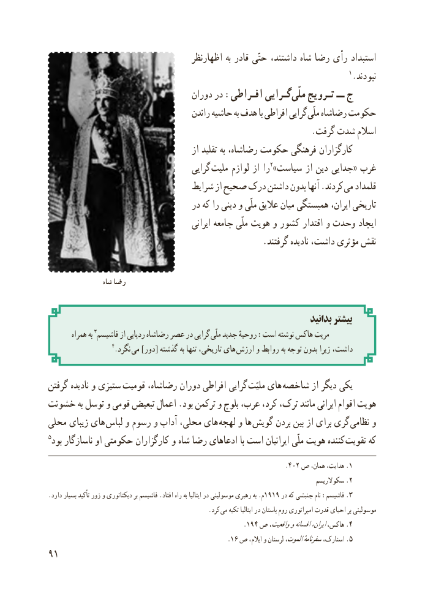

# PDF page 99

اظهارنظر به قادر حتّی داشتند، شاه رضا رأی استبداد
                                                                                 1.نبودند
                                   دوران در :افـراطی گـرایی  ملّی تـرویج ــ ج
                                       راندن حاشیه به هدف با افراطی گرایی ملّی رضاشاه حکومت
                                                             .گرفت شدت اسالم
                                          از تقلید به رضاشاه، حکومت فرهنگی کارگزاران
                                       گرایی  ملیت لوازم از را2» سیاست از دین جدایی « غرب
                                 شرایط از صحیح درک داشتن بدون آنها .کردند می قلمداد
                                  در که را دینی و ملّی عالیق میان همبستگی ایران، تاریخی
                                              ایرانی جامعه ملّی هویت و کشور اقتدار و وحدت ایجاد
                                                  .گرفتند نادیده داشت، مؤثری نقش

                  شاه رضا

                                                                          بدانید بیشتر
        همراه به 3فاشیسم از ردپایی رضاشاه عصر در گرایی ملّی جدید روحیهٔ :است نوشته هاکس مریت
                      4. نگرد  می ]دور[ گذشته به تنها تاریخی، های  ارزش و روابط به توجه بدون زیرا داشت،

گرفتن نادیده و ستیزی  قومیت رضاشاه، دوران افراطی گرایی ملیّت های شاخصه از دیگر یکی
خشونت به توسل و قومی تبعیض اعمال .بود ترکمن و بلوچ عرب، کرد، ترک، مانند ایرانی اقوام هویت
محلی زیبای های لباس و رسوم و آداب محلی، های  لهجه و ها  گویش بردن بین از برای گری  نظامی و
5بود ناسازگار او حکومتی کارگزاران و شاه رضا ادعاهای با است ایرانیان ملّی هویت کننده  تقویت که
                                                                 .402 ص همان، هدایت، .1
                                                                                     سکوالریسم .2
.دارد بسیار تأکید زور و دیکتاتوری بر فاشیسم .افتاد راه به ایتالیا در موسولینی رهبری به .م1919 در که جنبشی نام :فاشیسم .3
                                                    .کرد می تکیه ایتالیا در باستان روم امپراتوری قدرت احیای بر موسولینی
                                                     .194 ص واقعیت،وافسانهایران،هاکس، .4
                                                   .16 ص ایالم، و لرستان الموت،سفرنامهٔاستارک، .5
91

