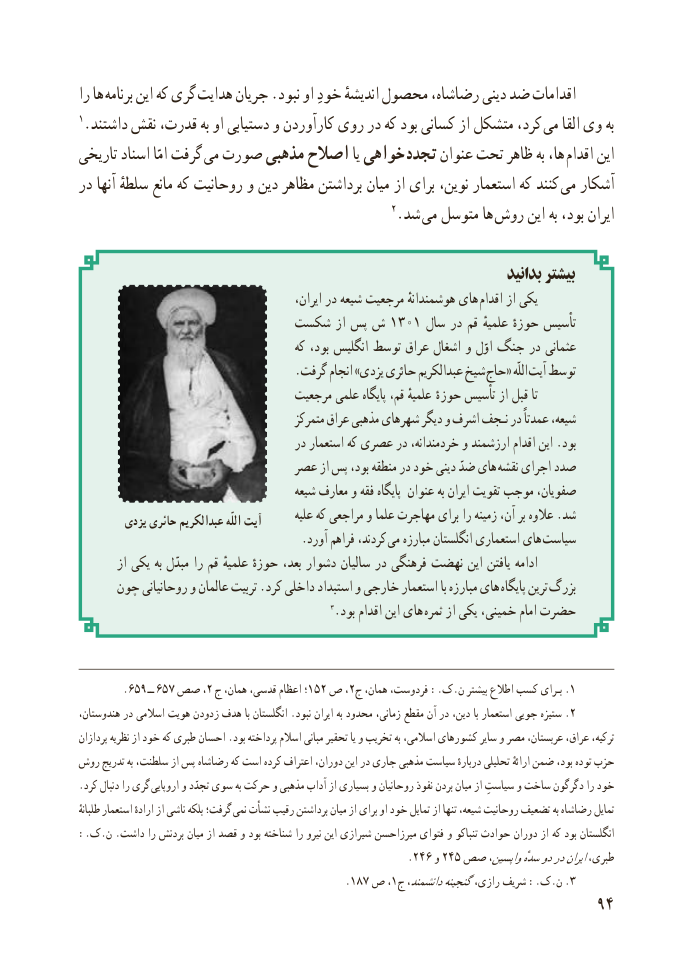

# PDF page 102

را ها برنامه این که گری هدایت جریان .نبود او خودِ اندیشهٔ محصول رضاشاه، دینی ضد اقدامات
1.داشتند نقش قدرت، به او دستیابی و کارآوردن روی در که بود کسانی از متشکل کرد،  می القا وی به
تاریخی اسناد امّا گرفت می صورت مذهبی اصالح یا خواهی  تجدد عنوان تحت ظاهر به ها، اقدام این
در آنها سلطهٔ مانع که روحانیت و دین مظاهر برداشتن میان از برای نوین، استعمار که کنند  می آشکار
                                                   2.شد  می متوسل ها  روش این به بود، ایران

                                                                          بدانید بیشتر
                                                ایران، در شیعه مرجعیت هوشمندانهٔ های اقدام از یکی
                        شکست از پس ش 1301 سال در قم علمیهٔ حوزهٔ تأسیس
                                         که بود، انگلیس توسط عراق اشغال و اوّل جنگ در عثمانی
                                    .گرفت انجام »یزدی حائری عبدالکریم شیخ حاج« اللّه آیت توسط
                                   مرجعیت علمی پایگاه قم، علمیهٔ  ٔه حوز تأسیس از قبل تا
                                            متمرکز عراق مذهبی شهرهای دیگر و اشرف نـجف در عمدتاً شیعه،
                                       در استعمار که عصری در خردمندانه، و ارزشمند اقدام این .بود
                             عصر از پس بود، منطقه در خود دینی ضدّ های نقشه اجرای صدد
                                         شیعه معارف و فقه پایگاه عنوان به ایران تقویت موجب صفویان،
        یزدی حائری عبدالکریم اللّه آیت       علیه که مراجعی و علما مهاجرت برای را زمینه آن، بر عالوه .شد
                                       .آورد فراهم کردند،  می مبارزه انگلستان استعماری های سیاست
        از یکی به مبدّل را قم علمیهٔ حوزهٔ بعد، دشوار سالیان در فرهنگی نهضت این یافتن ادامه
     چون روحانیانی و عالمان تربیت .کرد داخلی استبداد و خارجی استعمار با مبارزه های  پایگاه ترین بزرگ
                                                    3.بود اقدام این های ثمره از یکی خمینی، امام حضرت

        .659 ــ  657  صص ،2 ج همان، قدسی، اعظام ؛152 ص ،2.ج همان، فردوست، .:ک.ن بیشتر اطالع کسب بـرای 1
،هندوستان در اسالمی هویت زدودن هدف با انگلستان .نبود ایران به محدود زمانی، مقطع آن در دین، با استعمار جویی ستیزه .2
پردازان نظریه از خود که طبری احسان .بود پرداخته اسالم مبانی تحقیر یا و تخریب به اسالمی، کشورهای سایر و مصر عربستان، عراق، ترکیه،
روش تدریج به سلطنت، از پس رضاشاه که است کرده اعتراف دوران، این در جاری مذهبی سیاست دربارهٔ تحلیلی ارائهٔ ضمن بود، توده حزب
.کرد دنبال را گری اروپایی و تجدّد سوی به حرکت و مذهبی آداب از بسیاری و روحانیان نفوذ بردن میان از سیاستِ و ساخت دگرگون را خود
طلبانهٔ  استعمار ارادهٔ از ناشی بلکه گرفت؛ نمی نشأت رقیب برداشتن میان از برای او خود تمایل از تنها شیعه، روحانیت تضعیف به رضاشاه تمایل
.:ک.ن .داشت را بردنش میان از قصد و بود شناخته را نیرو این شیرازی میرزاحسن فتوای و تنباکو حوادث دوران از که بود انگلستان
                                                       .246 و 245 صص واپسین،سدهٔدودرایرانطبری،
                                                     .187 ص ،1ج دانشمند،گنجینه ،رازی شریف .:ک.ن .3
                                                           94

