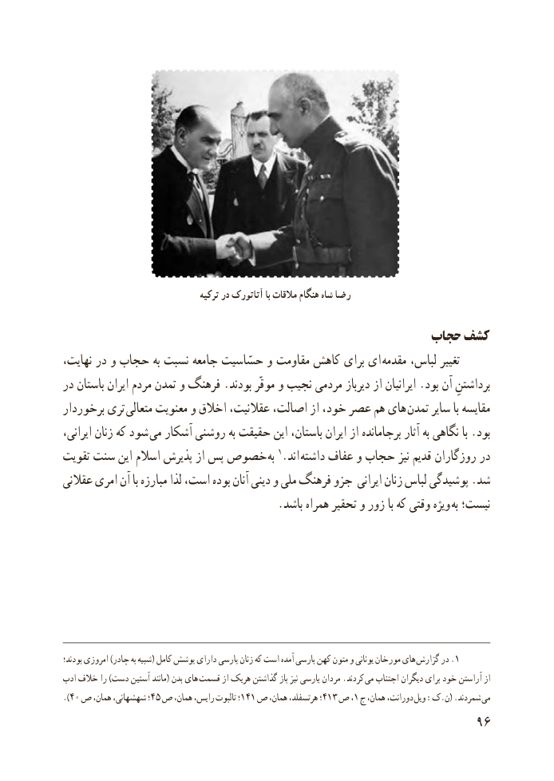

# PDF page 104

ترکیه در آتاتورک با مالقات هنگام شاه رضا

                                                  حجاب کشف
نهایت، در و حجاب به نسبت جامعه حسّاسیت و مقاومت کاهش برای ای مقدمه لباس، تغییر
در باستان ایران مردم تمدن و فرهنگ .بودند موقّر و نجیب مردمی دیرباز از ایرانیان .بود آن برداشتنِ
برخوردار تری متعالی معنویت و اخالق عقالنیت، اصالت، از خود، عصر هم های تمدن سایر با مقایسه
ایرانی، زنان که شود می آشکار روشنی به حقیقت این باستان، ایران از برجامانده آثار به نگاهی با .بود
تقویت سنت این اسالم پذیرش از پس خصوص به 1.اند داشته عفاف و حجاب نیز قدیم روزگاران در
عقالنی امری آن با مبارزه لذا است، بوده آنان دینی و ملی فرهنگ جزو ایرانی زنان لباس پوشیدگی .شد
                                       .باشد همراه تحقیر و زور با که وقتی ویژه  به نیست؛

بودند؛ امروزی )چادر به شبیه( کامل پوشش دارای پارسی زنان که است آمده پارسی کهن متون و یونانی مورخان های .گزارش در 1
ادب خالف را )دست آستین مانند( بدن های قسمت از هریک گذاشتن باز نیز پارسی مردان .کردند  می اجتناب دیگران برای خود آراستن از
).40 ص همان، شهشهانی، ؛45 ص همان، رایس، تالبوت ؛141 ص همان، هرتسفلد، ؛413 ص١، ج همان، دورانت، ویل :ک.ن( .شمردند می
                                                           96

