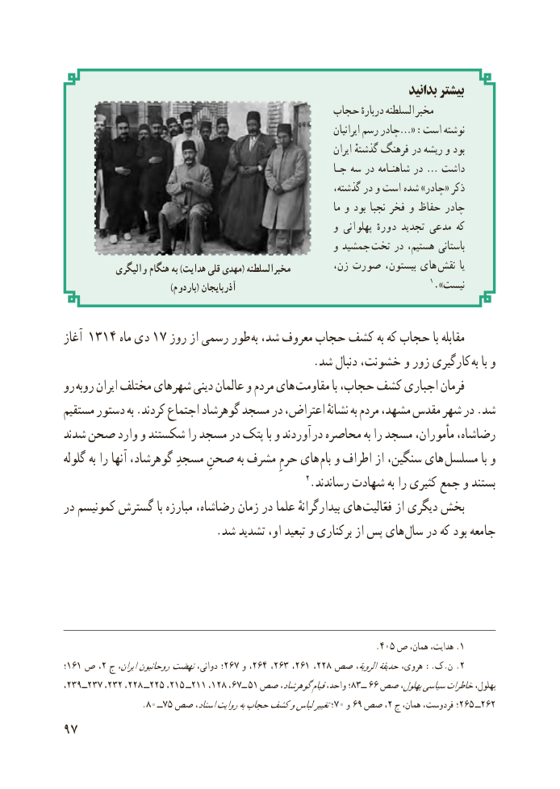

# PDF page 105

بدانید بیشتر
                                          حجاب دربارهٔ السلطنه مخبر
                                                                                 ایرانیان رسم چادر«… :است نوشته
                                                                         ایران گذشتهٔ فرهنگ در ریشه و بود
                                                             جـا سه در شاهنـامه در … داشت
                                                           گذشته، در و است شده »چادر« ذکر
                                                                              ما و بود نجبا فخر و حفاظ چادر
                                                        و پهلوانی دورهٔ تجدید مدعی که
                                                        و جمشید  تخت در هستیم، باستانی
            والیگری هنگام به )هدایت قلی مهدی( مخبرالسلطنه         زن، صورت بیستون، های  نقش  یا
                                       )باردوم( آذربایجان                                            1.»نیست

آغاز 1314 ماه دی 17 روز از رسمی طور  به شد، معروف حجاب کشف به که حجاب با مقابله
                                            .شد دنبال خشونت، و زور کارگیری  به با و
رو روبه ایران مختلف شهرهای دینی عالمان و مردم های  مقاومت با حجاب، کشف اجباری فرمان
مستقیم دستور به .کردند اجتماع گوهرشاد مسجد در اعتراض، نشانهٔ به مردم مشهد، مقدس شهر در .شد
شدند صحن وارد و شکستند را مسجد در پتک با و آوردند  در محاصره به را مسجد مأموران، رضاشاه،
گلوله به را آنها گوهرشاد، مسجدِ صحنِ به مشرف حرمِ های  بام و اطراف از سنگین، های  مسلسل با و
                                                 2.رساندند شهادت به را کثیری جمع و بستند
در کمونیسم گسترش با مبارزه رضاشاه، زمان در علما بیدارگرانهٔ های فعّالیت از دیگری بخش
  . شد تشدید او، تبعید و برکناری از پس های سال در که بود جامعه

                                                                 .405 ص همان، هدایت، .1
؛161 ص ،2 ج ایران،روحانیوننهضتدوانی، ؛267 و ،264 ،263 ،261 ،228 صص الرویة،حدیقةهروی، .:ک.ن .2
،٢٣٩ــ٢٣٧ ،٢٣٢ ،٢٢٨ ــ٢٢٥ ،٢١٥ ــ٢١١ ،١٢،٨٦٧ــ ٥١ صص گوهرشاد،قیامواحد، ؛83ــ 66 صص بهلول،سیاسیخاطراتبهلول،
                   .٨٠ ــ٧٥ صص اسناد،روایتبهحجابکشفولباستغییر؛70 و 69 صص ،2 ج٢٦٥همان، فردوست، ؛        ــ٢٦٢
97

