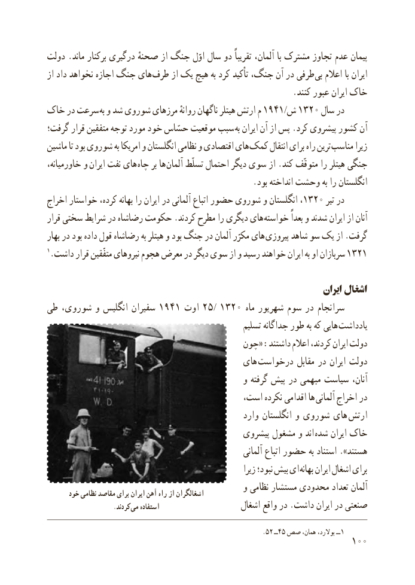

# PDF page 108

دولت .ماند برکنار درگیری صحنهٔ از جنگ اوّل سال دو تقریباً آلمان، با مشترک تجاوز عدم پیمان
از داد نخواهد اجازه جنگ های طرف از یک هیچ به کرد تأکید جنگ، آن در طرفی  بی اعالم با ایران
                                                           .کنند عبور ایران خاک
خاک در سرعت  به و شد شوروی مرزهای روانهٔ ناگهان هیتلر ارتش م 1941/ ش 1320 سال در
گرفت؛ قرار متفقین توجه مورد خود حسّاس موقعیت سبب به ایران آن از پس .کرد پیشروی کشور آن
ماشین تا بود شوروی به امریکا و انگلستان نظامی و اقتصادی های کمک انتقال برای راه ترین مناسب زیرا
خاورمیانه، و  ایران نفت های چاه بر ها آلمان تسلّط احتمال دیگر سوی از .کند متوقّف را هیتلر جنگی
                                                 .بود انداخته وحشت به را انگلستان
اخراج خواستار کرده، بهانه را ایران در آلمانی اتباع حضور شوروی و انگلستان ،1320 تیر در
قرار سختی شرایط در رضاشاه حکومت .کردند مطرح را دیگری های خواسته بعداً و شدند ایران از آنان
بهار در بود داده قول رضاشاه به هیتلر و بود جنگ در آلمان مکرّر های پیروزی شاهد سو یک از .گرفت
1.داشت قرار متفّقین نیروهای هجوم معرض در دیگر سوی از و رسید خواهند ایران به او سربازان 1321

                                                                         ایران اشغال
طی شوروی، و انگلیس سفیران 1941 اوت 25/ 1320 ماه شهریور سوم در سرانجام
                                                       تسلیم جداگانه طور به که هایی یادداشت
                                     چون« :داشتند اعالم کردند، ایران دولت
                                          های  درخواست مقابل در ایران دولت
                                               و گرفته پیش در مبهمی سیاست آنان،
                                        است، نکرده اقدامی ها  آلمانی اخراج در
                                                   وارد انگلستان و شوروی های  ارتش
                                             پیشروی مشغول و اند شده ایران خاک
                                                              آلمانی اتباع حضور به استناد ».هستند
                                                                زیرا نبود؛ بیش ای بهانه ایران اشغال برای
                                               و نظامی مستشار محدودی تعداد آلمان      خود نظامی مقاصد برای ایران آهن راه از اشغالگران
       . کردند می استفاده                     اشغال واقع در .داشت ایران در صنعتی

                                                                                     .52  ــ45 صص همان، بوالرد، ــ 1
                                                          100

