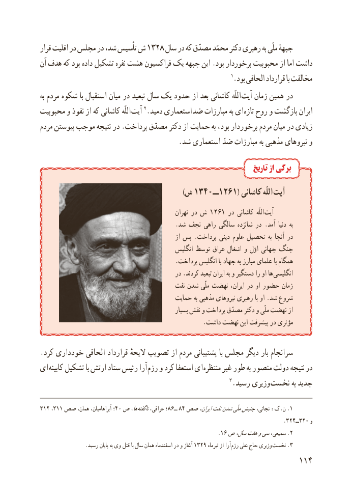

# PDF page 122

قرار اقلیت در مجلس در شد، تأسیس ش 1328 سال در که مصدّق محمّد دکتر رهبری به ملّی جبههٔ
آن هدف که بود داده تشکیل نفره هشت فراکسیون یک جبهه این .بود برخوردار محبوبیت از اما داشت
                                                                  1.بود الحاقی قرارداد با مخالفت
به مردم شکوه با استقبال میان در تبعید سال یک حدود از بعد کاشانی اللّه آیت زمان همین در
محبوبیت و نفوذ از که کاشانی اللّه  آیت 2.دمید استعماری ضد مبارزات به ای تازه روح و بازگشت ایران
مردم پیوستن موجب نتیجه در .پرداخت مصدّق دکتر از حمایت به بود، برخوردار مردم میان در زیادی
                                       .شد استعماری ضدّ مبارزات به مذهبی نیروهای و

                                                                          تاریخ از برگی
                        )1340ش       ــ1261( کاشانی اللّه آیت
                                                    تهران در ش 1261 در کاشانی  اللّه آیت
                                            .شد نجف راهی سالگی شانزده در .آمد دنیا  به
                                                       از پس .پرداخت دینی علوم تحصیل به آنجا در
                                              انگلیس توسط عراق اشغال و اوّل جهانی جنگ
                                            .پرداخت انگلیس با جهاد به مبارز علمای با همگام
                                             در .کردند تبعید ایران به و دستگیر را او ها انگلیسی
                                          نفت شدن ملّی نهضت ایران، در او حضور زمان
                                         حمایت به مذهبی نیروهای رهبری با او .شد شروع
                                                     بسیار نقش و پرداخت مصدّق دکتر و ملّی نهضت از
                                                     .داشت نهضت این پیشرفت در مؤثری

.کرد خودداری الحاقی قرارداد الیحهٔ تصویب از مردم پشتیبانی با مجلس دیگر بار سرانجام
ای  کابینه تشکیل با ارتش ستاد رئیس آرا رزم و کرد استعفا ای  منتظره غیر طور به منصور دولت نتیجه  در
                                                             3.رسید وزیری نخست به جدید

312 ،31١ صص همان، آبراهامیان، ؛40 ص ها، ناگفتهعراقی، ؛86ــ  84 صص١ایران،نفتشدنملّیجنبشنجاتی، :ک.ن .
                                                                                .324ــ320 و
                                                            .16 ص سال،هفتوسیسمیعی، .٢
  .1329رسید پایان به وی قتل با سال همان اسفندماه در و آغاز         تیرماه از آرا رزم علی حاج وزیری  نخست .٣
                                                          114

