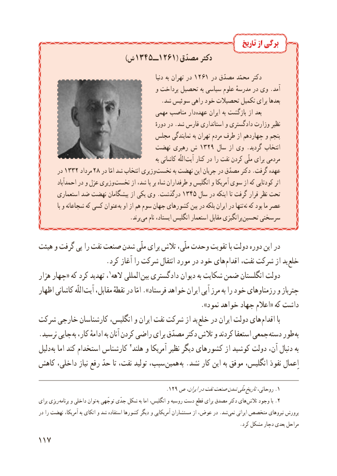

# PDF page 125

تاریخ از برگی
                                        )ش 1345 ــ1261( مصدّق دکتر
                                                             دنیا به تهران در 1261 در مصدّق محمّد دکتر
                                         و پرداخت تحصیل به سیاسی علوم مدرسهٔ در وی .آمد
                                          .شد سوئیس راهی خود تحصیالت تکمیل برای بعدها
                                       مهمی مناصب دار  عهده ایران به بازگشت از بعد
                                                         دورهٔ در .شد فارس استانداری و دادگستری وزارت نظیر
                                مجلس نمایندگی به تهران مردم طرف از چهاردهم و پنجم
                               نهضت رهبری ش 1923 سال از وی .گردید انتخاب
                                                                   به کاشانی اللّه  آیت کنار در را نفت کردن ملّی برای مردمی
       در 1233 مرداد  28 در امّا شد انتخاب وزیری نخست به نهضت این جریان در مصدّق دکتر .گرفت عهده
        احمدآباد در و عزل وزیری نخست از شد، پا بر شاه طرفداران و انگلیس و آمریکا سوی از که کودتایی اثر
       استعماری ضد نهضت پیشگامان از یکی وی .درگذشت 1345 سال در اینکه تا گرفت قرار نظر تحت
             با و شجاعانه که کسی عنوان  به او از هم سوم جهان کشورهای بین در بلکه ایران در تنها نه که بود ما عصر
               . برند می نام ایستاد، انگلیس استعمار مقابل برانگیزی تحسین سرسختی

هیئت و گرفت پی را نفت صنعت شدن ملّی برای تالش ملّی، وحدت تقویت با دولت دوره این در
 . کرد آغاز را شرکت انتقال مورد در خود های اقدام نفت، شرکت از ید خلع
هزار چهار« که کرد تهدید ،1الهه المللی بین دادگستری دیوان به شکایت ضمن انگلستان دولت
اظهار کاشانی اللّه آیت مقابل، نقطهٔ در امّا ».فرستاد خواهد ایران آبی مرز به را خود رزمناوهای و چترباز
                                                    ».نمود خواهد جهاد اعالم« که داشت
شرکت خارجی کارشناسان انگلیس، و ایران نفت شرکت از ید خلع در ایران دولت های اقدام با
.نرسید جایی به کار، ادامهٔ به آنان کردن راضی برای مصدّق دکتر تالش و کردند استعفا جمعی دسته طور به
دلیل به اما کند استخدام کارشناس 2هلند و آمریکا نظیر دیگر کشورهای از کوشید دولت آن، دنبال به
کاهش داخلی، نیاز رفع حدّ تا نفت، تولید سبب، همین  به .نشد کار این به موفق انگلیس، نفوذ ِاعمال

                                            .129 ص ایران،درنفتصنعتشدنملّیتاریخروحانی، .1
برای ریزی  برنامه و داخلی توان به توجّهی جدّی شکل به اما انگلیس، و روسیه دست قطع برای مصدق دکتر های .تالش وجود با 2
در را نهضت آمریکا، به اتکای و شد استفاده کشورها دیگر و آمریکایی مستشاران از عوض، در .شد نمی ایرانی متخصص نیروهای پرورش
                                                                                   .کرد مشکل دچار بعدی مراحل
117

