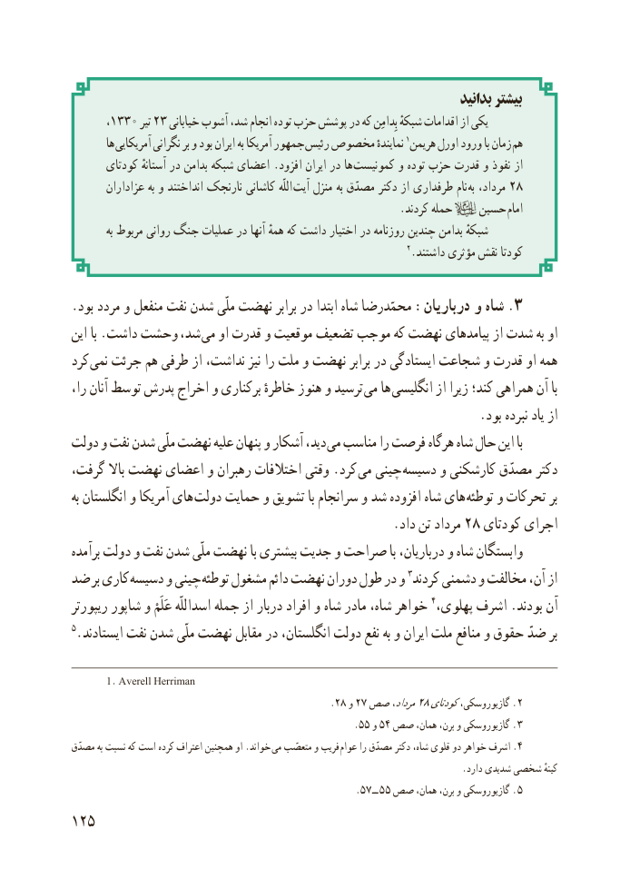

# PDF page 133

بدانید بیشتر
        ، ١٣٣٠ تیر ٣٢ خیابانی آشوب شد، انجام توده حزب پوشش در که بِدامِن شبکهٔ اقدامات از یکی
        ها آمریکایی نگرانی بر و بود ایران به آمریکا جمهور رئیس مخصوص نمایندهٔ 1هریمن اورل ورود با زمان هم
       کودتای آستانهٔ در بدامن شبکه اعضای .افزود ایران در ها کمونیست و توده حزب قدرت و نفوذ از
       عزاداران به و انداختند نارنجک کاشانی اللّه آیت منزل به مصدّق دکتر از طرفداری نام  به٨مرداد، ٢
                                                            .کردند حمله    حسین امام
          به مربوط روانی جنگ عملیات در آنها همهٔ که داشت اختیار در روزنامه چندین بدامن شبکهٔ
                                                                       2.داشتند مؤثری نقش کودتا

.بود مردد و منفعل نفت شدن ملّی نهضت برابر در ابتدا شاه محمّدرضا :درباریان و شاه .3
این با .داشت وحشت شد، می او قدرت و موقعیت تضعیف موجب که نهضت پیامدهای از شدت به او
کرد نمی جرئت هم طرفی از نداشت، نیز را ملت و نهضت برابر در ایستادگی شجاعت و قدرت او همه
را، آنان توسط پدرش اخراج و برکناری خاطرهٔ هنوز و ترسید می ها انگلیسی از زیرا کند؛ همراهی آن با
                                                                .بود نبرده یاد از
دولت و نفت شدن ملّی نهضت علیه پنهان و آشکار دید، می مناسب را فرصت هرگاه شاه حال این با
گرفت، باال نهضت اعضای و رهبران اختالفات وقتی .کرد می چینی  دسیسه و کارشکنی مصدّق دکتر
به انگلستان و آمریکا های  دولت حمایت و تشویق با سرانجام و شد افزوده شاه های توطئه و تحرکات بر
                                                   .داد تن مرداد ٢٨ کودتای اجرای
برآمده دولت و نفت شدن ملّی نهضت با بیشتری جدیت و صراحت با درباریان، و شاه وابستگان
ضد بر کاری دسیسه و چینی توطئه مشغول دائم نهضت دوران طول در و 3کردند دشمنی و مخالفت آن، از
ریپورتر شاپور و عَلَمْ اسداللّه جمله از دربار افراد و شاه مادر شاه، خواهر 4،آنپهلوی اشرف .بودند
5.ایستادند نفت شدن ملّی نهضت مقابل در انگلستان، دولت نفع به و ایران ملت منافع و حقوق ضدّ بر

       1. Averell Herriman
                                                 .28 و 27 صص٨مرداد،٢کودتایگازیوروسکی، . 2
                                                       .5٥ و 54 صص همان، برن، و گازیوروسکی .  3
مصدّق به نسبت که است کرده اعتراف همچنین او .خواند می متعصّب و فریب  .عوام را مصدّق دکتر شاه، قلوی دو خواهر اشرف 4
                                                                                      .دارد شدیدی شخصی کینهٔ
                                                              .57 ــ 55 صص همان، برن، و گازیوروسکی .  5
152

