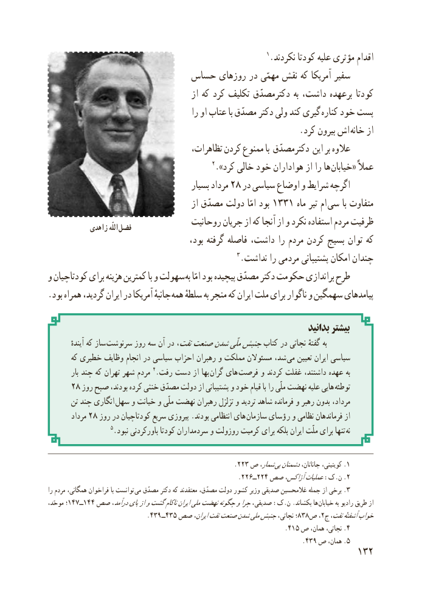

# PDF page 140

1.نکردند کودتا علیه مؤثری اقدام
                       حساس روزهای در مهمّی نقش که آمریکا سفیر
                                         از که کرد تکلیف دکترمصدّق به داشت، برعهده کودتا
                                          را او عتاب با مصدّق دکتر ولی کند گیری کناره خود پست
          . کرد بیرون اش خانه از
                                     تظاهرات، کردن ممنوع با دکترمصدّق این بر عالوه
                                             2.»کرد خالی خود هواداران از را ها خیابان« عمالً
                                        بسیار مرداد 28 در سیاسی اوضاع و شرایط اگرچه
                                          از مصدّق دولت امّا بود 1331 ماه تیر ام  سی با متفاوت
                                  روحانیت جریان از که آنجا از و نکرد استفاده مردم ظرفیت            زاهدی اللّه فضل
                                        بود، گرفته فاصله داشت، را مردم کردن بسیج توان که
                                                   3.نداشت را مردمی پشتیبانی امکان چندان
و کودتاچیان برای هزینه کمترین با و سهولت به امّا بود پیچیده مصدّق دکتر حکومت براندازی طرح
. بود همراه گردید، ایران در آمریکا جانبهٔ همه سلطهٔ به منجر که ایران ملت برای ناگوار و سهمگین پیامدهای

                                                                          بدانید بیشتر
           آیندهٔ که ساز  سرنوشت روز سه آن در نفت،صنعتشدنملّیجنبشکتاب در نجاتی گفتهٔ به
       که خطیری وظایف انجام در سیاسی احزاب رهبران و مملکت مسئوالن شد، می تعیین ایران سیاسی
         بار چند که تهران شهر مردم 4.رفت دست از بها  گران های  فرصت و کردند غفلت داشتند، عهده به
     28 روز صبح بودند، کرده خنثی مصدّق دولت از پشتیبانی و خود قیام با را ملّی نهضت علیه هایی  توطئه
       تن چند انگاری سهل و خیانت و ملّی نهضت رهبران تزلزل و تردید شاهد فرمانده و رهبر بدون مرداد،
        مرداد 28 روز در کودتاچیان سریع پیروزی .بودند انتظامی های سازمان رؤسای و نظامی فرماندهان از
                    5.نبود باورکردنی کودتا سردمداران و روزولت کرمیت برای بلکه ایران ملّت برای تنها نه

                                                   .223 ص شمار، .بیدشمنانجاناتان، کویتینی، 1
                                                    .226ــ224 صص آژاکس،عملیات:ک.ن .2
را مردم همگانی، فراخوان با توانست  .می مصدّق دکتر که معتقدند مصدّق، دولت کشور وزیر صدیقی غالمحسین جمله از برخی 3
،؛موحّد 147ــ144 صص درآمد،پایازوگشتناکامایرانملینهضتچگونهوچراصدیقی، :ک.ن .بکشاند ها  خیابان به رادیو طریق از
                           .439ــ435 صص ایران،نفتصنعتشدنملیجنبشنجاتی، ؛838ص٢خواب، ج نفت،آشفتهٔ
                                                                 .415 ص همان، نجاتی، .4
                                                                      .439 ص همان، .5
                                                          132

