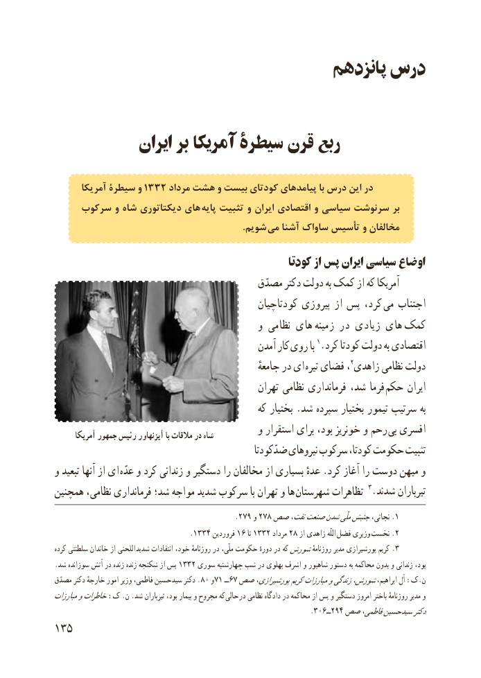

# PDF page 143

پانزدهم درس

             ایران بر آمریکا سیطرۀ قرن ربع

       آمریکا سیطرة و 1332 مرداد هشت و بیست کودتای پیامدهای با درس این در
     سرکوب و شاه دیکتاتوری های پایه تثبیت و ایران اقتصادی و سیاسی سرنوشت بر
                                                                                   .شویم می آشنا ساواک تأسیس و مخالفان

                                                   کودتا از پس ایران سیاسی اوضاع
                                          مصدّق دکتر دولت به کمک از که آمریکا
                                               کودتاچیان پیروزی از پس کرد،  می اجتناب
                                            و نظامی های  زمینه در زیادی های  کمک
                                               آمدن کار روی با 1.کرد کودتا دولت به اقتصادی
                                                         جامعهٔ در ای  تیره فضای ،2زاهدی نظامی دولت
                                                  تهران نظامی فرمانداری شد، فرما  حکم ایران
                                                 که بختیار .شد سپرده بختیار تیمور سرتیپ به
       آمریکا جمهور رئیس آیزنهاور با مالقات در شاه         و استقرار برای بود، خونریز و رحم بی افسری
                                                 ضدّکودتا نیروهای سرکوب کودتا، حکومت تثبیت
و تبعید آنها از ای عدّه و کرد زندانی و دستگیر را مخالفان از بسیاری عدهٔ .کرد آغاز را دوست میهن و
همچنین نظامی، فرمانداری شد؛ مواجه شدید سرکوب با تهران و ها شهرستان تظاهرات 3.شدند تیرباران
                                            .279 و 278 صص نفت،صنعتشدنملّیجنبشنجاتی، .1
                                 .1334 فروردین 16 تا 1332 مرداد 28 از زاهدی اللّه فضل وزیری .نخست 2
 کرده سلطنتی خاندان از اللحنی .شدید انتقادات خود، روزنامهٔ در ملّی، حکومت دورهٔ در کهشورشروزنامهٔ مدیر پورشیرازی کریم 3
 .شد سوزانده آتش در زنده زنده شکنجه از پس 1332 سوری چهارشنبه شب در پهلوی اشرف و شاهپور دستور به محاکمه بدون و زندانی بود،
 مصدّق دکتر خارجهٔ امور وزیر فاطمی، سیدحسین دکتر .80 و71 ــ67 صص پورشیرازی،کریممبارزاتوزندگیشورش،ابراهیم، آل :ک.ن
مبارزاتوخاطرات:ک .ن .شد تیرباران بود، بیمار و مجروح که حالی در نظامی دادگاه در محاکمه از پس و دستگیر امروز باختر روزنامهٔ مدیر و
                                                                .306ــ294 صص فاطمی،سیدحسیندکتر
135

