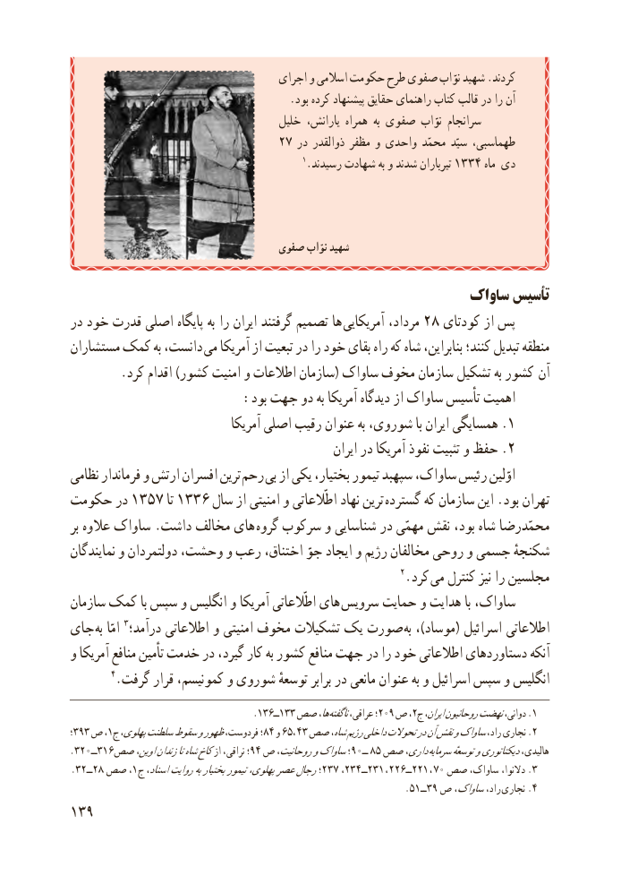

# PDF page 147

اجرای و اسالمی حکومت طرح صفوی نوّاب شهید .کردند
                                         .بود کرده پیشنهاد حقایق راهنمای کتاب قالب در را آن
                                     خلیل یارانش، همراه  به صفوی نوّاب سرانجام
                               27 در ذوالقدر مظفر و واحدی محمّد سیّد طهماسبی،
                                                  1.رسیدند شهادت به و شدند تیرباران 1433 ماه  دی

                                صفوی نوّاب شهید

                                                   ساواک تأسیس
در خود قدرت اصلی پایگاه به را ایران گرفتند تصمیم ها آمریکایی مرداد، 28 کودتای از پس
مستشاران کمک به دانست، می آمریکا از تبعیت در را خود بقای راه که شاه بنابراین، کنند؛ تبدیل منطقه
. کرد اقدام )کشور امنیت و اطالعات سازمان( ساواک مخوف سازمان تشکیل به کشور آن
                      :بود جهت دو به آمریکا دیدگاه از ساواک تأسیس اهمیت
                                 آمریکا اصلی رقیب عنوان به شوروی، با ایران همسایگی .1
                                                       ایران در آمریکا نفوذ تثبیت و حفظ .2
نظامی فرماندار و ارتش افسران ترین رحم بی از یکی بختیار، تیمور سپهبد ساواک، رئیس اوّلین
حکومت در 1357 تا 1336 سال از امنیتی و اطّالعاتی نهاد ترین  گسترده که سازمان این .بود تهران
بر عالوه ساواک .داشت مخالف های گروه سرکوب و شناسایی در مهمّی نقش بود، شاه محمّدرضا
نمایندگان و دولتمردان وحشت، و رعب اختناق، جوّ ایجاد و رژیم مخالفان روحی و جسمی شکنجهٔ
                                                            2.کرد می کنترل نیز را مجلسین
سازمان کمک با سپس و انگلیس و آمریکا اطّالعاتی های  سرویس حمایت و هدایت با ساواک،
جای  به امّا 3درآمد؛ اطالعاتی و امنیتی مخوف تشکیالت یک صورت به ،)موساد( اسرائیل اطالعاتی
و آمریکا منافع تأمین خدمت در گیرد، کار به کشور منافع جهت در را خود اطالعاتی دستاوردهای آنکه
        4.گرفت قرار کمونیسم، و شوروی توسعهٔ برابر در مانعی عنوان به و اسرائیل سپس و انگلیس
                                         .١ــ٦٣١ها،٣٣ صص  ناگفتهعراقی، ؛209 ص ،2.ج١ایران،روحانیوننهضتدوانی،
؛393 ص ،1ج پهلوی،سلطنتسقوطوظهورفردوست، ؛84 و 65، 43 صص شاه،رژیمداخلیتحوالتدرآننقشوساواکراد، نجاری .2
.320ــ316صص اوین،زندانتاشاهکاخاز نراقی، ؛94 ص روحانیت،وساواک؛90ــ 85 صص داری، سرمایهتوسعهٔودیکتاتوریهالیدی،
.32ــ28 صص ،1ج٢،اسناد،روایتبهبختیارتیمورپهلوی،عصررجال؛ ٧٣٢ــ٤٣٢٣١ ، ٢٢ــ٦٢٢١  ، ٧٠ صص ساواک، دالنوا، .3
                                                                .51ــ39 ص ساواک،راد،  .نجاری 4
139

