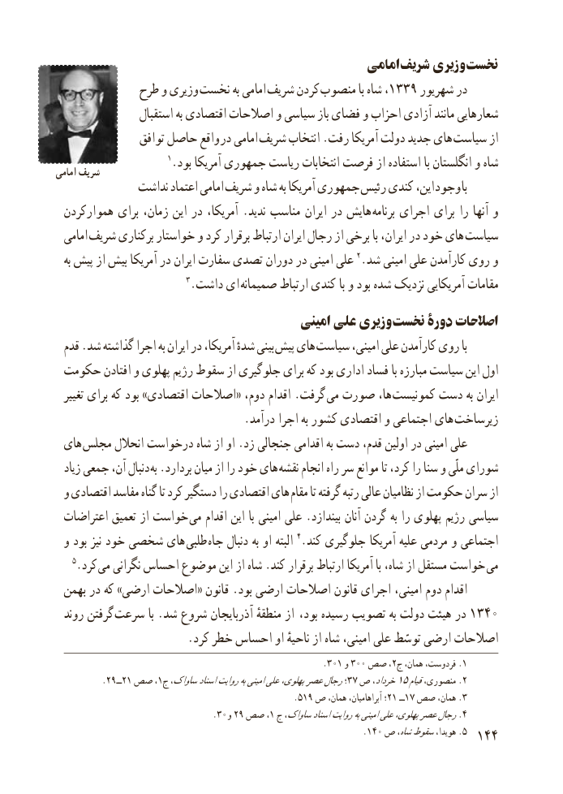

# PDF page 152

امامی شریف وزیری نخست
             طرح و وزیری  نخست به امامی شریف کردن منصوب با شاه ،1339 شهریور در
                 استقبال به اقتصادی اصالحات و سیاسی باز فضای و احزاب آزادی مانند شعارهایی
                 توافق حاصل واقع  در امامی شریف انتخاب .رفت آمریکا دولت جدید های  سیاست از
                       1.بود آمریکا جمهوری ریاست انتخابات فرصت از استفاده با انگلستان و شاهامامی شریف
              نداشت اعتماد امامی شریف و شاه به آمریکا جمهوری رئیس کندی این، وجود با
 هموارکردن برای زمان، این در آمریکا، . ندید مناسب ایران در هایش  برنامه اجرای برای را آنها و
  امامی شریف برکناری خواستار و کرد برقرار ارتباط ایران رجال از برخی با ایران، در خود های سیاست
  به پیش از بیش آمریکا در ایران سفارت تصدی دوران در امینی علی 2.شد امینی علی کارآمدن روی و
                          3.داشت ای صمیمانه ارتباط کندی با و بود شده نزدیک آمریکایی مقامات
                                         امینی علی وزیری نخست دورۀ اصالحات
  قدم .شد گذاشته اجرا به ایران در آمریکا، شدهٔ بینی پیش های سیاست امینی، علی کارآمدن روی با
 حکومت افتادن و پهلوی رژیم سقوط از جلوگیری برای که بود اداری فساد با مبارزه سیاست این اول
  تغییر برای که بود »اقتصادی اصالحات« دوم، اقدام .گرفت می صورت ها، کمونیست دست به ایران
  . درآمد اجرا به کشور اقتصادی و اجتماعی های زیرساخت
 های مجلس انحالل درخواست شاه از او .زد جنجالی اقدامی به دست قدم، اولین در امینی علی
  زیاد جمعی آن، دنبال به .بردارد میان از را خود های نقشه انجام راه سر موانع تا کرد، را سنا و ملّی شورای
 و اقتصادی مفاسد گناه تا کرد دستگیر را اقتصادی های مقام تا گرفته رتبه عالی نظامیان از حکومت سران از
 اعتراضات تعمیق از خواست  می اقدام این با امینی علی .بیندازد آنان گردن به را پهلوی رژیم سیاسی
 و بود نیز خود شخصی های  طلبی جاه دنبال به او البته 4.کند جلوگیری آمریکا علیه مردمی و اجتماعی
   5.کرد می نگرانی احساس موضوع این از شاه .کند برقرار ارتباط آمریکا با شاه، از مستقل خواست می
 بهمن در که »ارضی اصالحات« قانون .بود ارضی اصالحات قانون اجرای امینی، دوم اقدام
  روند گرفتن  سرعت با .شد شروع آذربایجان منطقهٔ از  ،بود رسیده تصویب به دولت هیئت در 1340
                       .کرد خطر احساس او ناحیهٔ از شاه امینی، علی توسّط ارضی اصالحات
                                                                  .٠٣ ١ و٢٠٠٣ صص ، ج همان، فردوست، .1
           . ٢ــ٩٢١ صص١؛، ج ساواک،اسنادروایتبهامینیعلیپهلوی،عصررجال 37 ص خرداد،15قیاممنصوری، .2
                                                 .519 ص٢١همان، آبراهامیان، ؛    ــ١ ٧ صص همان، 3.
                                       .٠٣ و٢،٩١صص  ج ساواک،اسنادروایتبهامینیعلیپهلوی،عصررجال.4
                                                               .140 ص شاه،سقوطهویدا، .5 144

