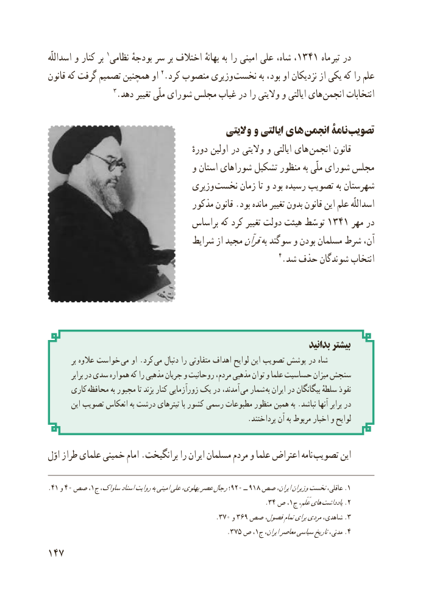

# PDF page 155

اسداللّه و کنار بر 1نظامی بودجهٔ سر بر اختالف بهانهٔ به را امینی علی شاه، ،1341 ماه تیر در
قانون که گرفت تصمیم همچنین او 2.کرد منصوب وزیری نخست به بود، او نزدیکان از یکی که را علم
                  3.دهد تغییر ملّی شورای مجلس غیاب در را والیتی و ایالتی های  انجمن انتخابات

                                          والیتی و ایالتی های انجمن نامۀ تصویب
                                               دورهٔ اولین در والیتی و ایالتی های  انجمن قانون
                                  و استان شوراهای تشکیل منظور به ملّی شورای مجلس
                                 وزیری نخست زمان تا و بود رسیده تصویب به شهرستان
                                  مذکور قانون .بود مانده تغییر بدون قانون این علم اسداللّه
                                 براساس که کرد تغییر دولت هیئت توسّط ١٣٤١ مهر در
                                 شرایط از مجیدقرآنبه سوگند و بودن مسلمان شرط آن،
                                                              4.شد حذف شوندگان انتخاب

                                                                          بدانید بیشتر
          بر عالوه خواست  می او .کرد  می دنبال را متفاوتی اهداف لوایح این تصویب پوشش در شاه
          برابر در سدی همواره که را مذهبی جریان و روحانیت مردم، مذهبی توان و علما حساسیت میزان سنجش
      کاری  محافظه به مجبور تا بزند کنار زورآزمایی یک در آمدند،  می شمار به ایران در بیگانگان سلطهٔ نفوذ
        این تصویب انعکاس به درشت تیترهای با کشور رسمی مطبوعات منظور همین به .نباشد آنها برابر در
                                                       .پرداختند آن به مربوط اخبار و لوایح

اوّل طراز علمای خمینی امام .برانگیخت را ایران مسلمان مردم و علما اعتراض نامه تصویب این

.41 و 40 صص١؛، ج ساواک،اسنادروایتبهامینیعلیپهلوی،عصررجال920 ــ 918 صص ایران،وزیراننخستعاقلی، .1
                                                             .34 ص ،1ج عَلَم،های .یادداشت 2
                                              .370 و 369 صص فصول،تمامبرایمردیشاهدی، 3.
                                                           .٧٣٥ ص١، ج ایران،معاصرسیاسیتاریخمدنی، .4
147

