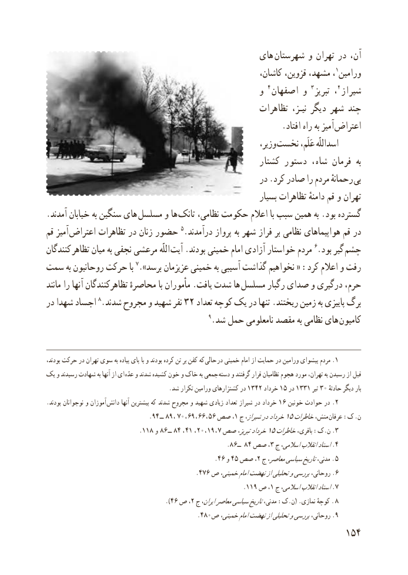

# PDF page 162

های  شهرستان و تهران در آن،
                                                        کاشان، قزوین، مشهد، ، 1ورامین
                                                    و 4 اصفهان و 3 تبریز ،2 شیراز
                                                    تظاهرات نیـز، دیگر شهر چند
         . افتاد راه به آمیز اعتراض
                                                               وزیر، نخست عَلَم، اسداللّه
                                                     کشتار دستور شاه، فرمان  به
                                                     در .کرد صادر را مردم رحمانهٔ بی
                                                              بسیار تظاهرات دامنهٔ قم و تهران
.آمدند خیابان به سنگین های  مسلسل و ها تانک نظامی، حکومت اعالم با سبب همین به .بود گسترده
قم آمیز اعتراض تظاهرات در زنان حضور 5.درآمدند پرواز به شهر فراز بر نظامی هواپیماهای قم در
کنندگان تظاهر میان به نجفی مرعشی اللّه آیت .بودند خمینی امام آزادی خواستار مردم 6.بود گیر چشم
سمت به روحانیون حرکت با 7.»برسد عزیزمان خمینی به آسیبی گذاشت نخواهیم « :کرد اعالم و رفت
مانند را آنها تظاهرکنندگان محاصرهٔ با مأموران .یافت شدت ها  مسلسل رگبار صدای و درگیری حرم،
در شهدا اجساد 8.شدند مجروح و شهید نفر 32 تعداد کوچه یک در تنها .ریختند زمین به پاییزی برگ
                                             9.شد حمل نامعلومی مقصد به نظامی های  کامیون

،کهبودند حرکت در تهران سوی به پیاده پای با و بودند کرده تن بر کفن     حالی .در خمینی امام از حمایت در ورامین پیشوای مردم 1
یک و رسیدند شهادت به آنها از ای  عدّه و شدند کشیده خون و خاک به جمعی  دسته و گرفتند قرار نظامیان هجوم مورد تهران، به رسیدن از قبل
       .1342شد تکرار ورامین کشتزارهای در      خرداد 15 در 1331 تیر 30 حادثهٔباردیگر
.بودند نوجوانان و آموزان  دانش آنها بیشترین که شدند مجروح و شهید زیادی تعداد شیراز در خرداد 16 خونین حوادث در .2
                                   .٩٤ ــ  ٩٨ ، ٠٧ ، ٩٦ ، ٦٦ ، ٥،٦١صص  ج شیراز،درخرداد15خاطراتمنش، عرفان :ک .ن
                                .١١٨  و  ٦٨ ــ  ٨٤ ، ٤١ ، ٢٠ ، ١٩ ، ٧ صص تبریز،خرداد15خاطراتباقری، :ک.ن 3.
                                                    .86ــ   84 صص ،3 ج٤اسالمی،انقالباسناد.
                                                 .46 و 45 صص ،2 ج معاصر،سیاسیتاریخمدنی، .  5
                                          .476 ص خمینی،امامنهضتازتحلیلیوبررسیروحانی، 6.
                                                        .119 ص ،1 ج اسالمی،انقالباسناد7.
                                       .)46 ص٢، ج ایران،معاصرسیاسیتاریخمدنی، :ک.ن( .نمازی کوچهٔ .  8
      .4809.ص خمینی،امامنهضتازتحلیلیوبررسیروحانی،
                                                          154

