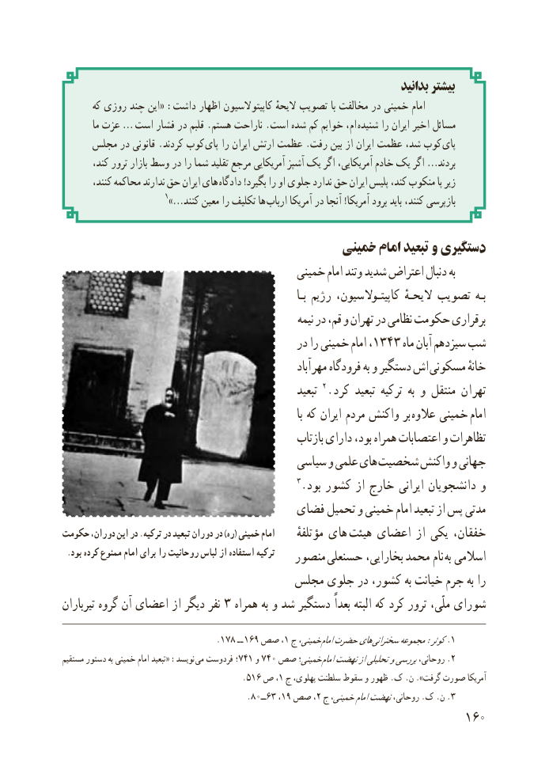

# PDF page 168

بدانید بیشتر
       که روزی چند این« :داشت اظهار کاپیتوالسیون الیحهٔ تصویب با مخالفت در خمینی امام
         ما عزت …  است فشار در قلبم .هستم ناراحت .است شده کم خوابم ام، شنیده را ایران اخیر مسائل
     مجلس در قانونی .کردند کوب  پای را ایران ارتش عظمت .رفت بین از ایران عظمت شد، کوب پای
       کند، ترور بازار وسط در را شما تقلید مرجع آمریکایی آشپز یک اگر آمریکایی، خادم یک اگر …بردند
        کنند، محاکمه ندارند حق ایران های دادگاه !بگیرد را او جلوی ندارد حق ایران پلیس کند، منکوب پا زیر
                1»…کنند معین را تکلیف ها  ارباب آمریکا در آنجا !آمریکا برود باید کنند، بازپرسی

                                          خمینی امام تبعید و دستگیری
                                         خمینی امام وتند شدید اعتراض دنبال به
                                                                           بـا رژیم کاپیتـوالسیون، الیحـهٔ تصویب بـه
                                                                                  نیمه در قم، و تهران در نظامی حکومت برقراری
                                            در را خمینی امام١٣٤شب،   ٣ ماه آبان سیزدهم
                                                                  آباد مهر فرودگاه به و دستگیر اش مسکونی خانهٔ
                                                         تبعید 2. کرد تبعید ترکیه  به و منتقل تهران
                                                                                  با که ایران مردم واکنش بر  عالوه خمینی امام
                                                     بازتاب دارای بود، همراه اعتصابات و تظاهرات
                                        سیاسی و علمی های شخصیت واکنش و جهانی
                                                3. بود کشور از خارج ایرانی دانشجویان و
                                  فضای تحمیل و خمینی امام تبعید از پس مدتی
حکومت دوران، این در .ترکیه در تبعید دوران در )ره( خمینی امام      مؤتلفهٔ های  هیئت اعضای از یکی خفقان،
 .بود کرده ممنوع امام برای را روحانیت لباس از استفاده ترکیه   منصور حسنعلی بخارایی، محمد نام به اسالمی
                                مجلس جلوی در کشور، به خیانت جرم به را
تیرباران گروه آن اعضای از دیگر نفر 3 همراه به و شد دستگیر بعداً البته که کرد ترور ملّی، شورای

                                       .١٨٧  ـ ـ ١،٩٦١صص  ج خمینی، امامحضرتهای .سخنرانیمجموعه:کوثر 1
مستقیم دستور به خمینی امام تبعید« :نویسد می فردوست ؛741 و٤خمینی؛٧ ٠ صص  .امامنهضتازتحلیلیوبررسیروحانی، 2
                                      .516 ص ،1 ج پهلوی، سلطنت سقوط و ظهور .ک .ن ».گرفت صورت آمریکا
                                               .٣٦ــ٠٨ ،١،٩ صص 2 ج خمینی،امامنهضتروحانی، .ک .ن 3.
                                                          106

