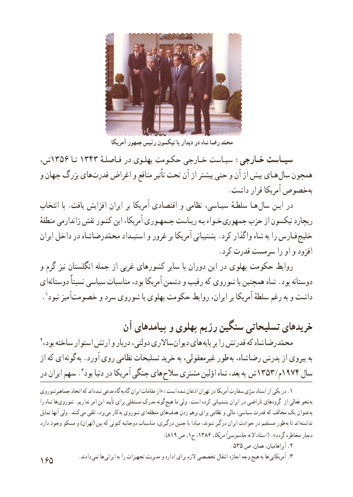

# PDF page 173

آمریکا جمهور رئیس نیکسون با دیدار در شاه رضا محمّد
،ش١٣٥ ٦١٣٤سیـاستتـا    ٣ فـاصلـهٔ در پهلـوی حکـومت خـارجی سیـاست :خـارجی
و جهان بزرگ های ​قدرت اغراض و منافع تأثیر تحت آن از بیشتر حتی و آن از پیش هـای  سال همچون
                                                     .داشت قرار آمریکا خصوصبه​
انتخاب  با . یافت افزایش ایران بر آمریکا اقتصادی و نظامی سیـاسی، سلطـهٔ هـا  سال ایـن در
منطقهٔ ژاندارمی نقش کشور این آمریکا، جـمهـوری ریـاست بـه خـواه  جمهوری حزب از نیکسون ریچارد
ایران داخل در شاه محمّدرضا استبـداد و غرور بر آمریکا پشتیبانی .کرد واگذار شاه به را فـارس  خلیج
                                                  .کرد قدرت سرمست را او و افزود
و گرم نیز انگلستان جمله از غربی کشورهای سایر با دوران این در پهلوی حکومت روابط
ای​دوستانه نسبتاً سیاسی مناسبات بود، آمریکا دشمن و رقیب که شوروی با همچنین شاه .بود دوستانه
 . 1نبود آمیز​خصومت و سرد شوروی با پهلوی حکومت روابط ایران، بر آمریکا سلطهٔ رغم به و داشت

                  آن پیامدهای و پهلوی رژیم سنگین تسلیحاتی خریدهای
2،ساالریبود ساخته استوار ارتش و دربار دولتی،              دیوان های پایه بر را قدرتش که شاه رضا محمّد
از که ای  گونه به .آورد روی نظامی تسلیحات خرید به غیرمعقولی، طور به شاه، رضا پدرش از پیروی به
در ایران سهم . 3بود دنیا در آمریکا جنگی های  سالح مشتری اوّلین شاه بعد، به  ش ١٣٥٣ / م1974 سال
جماهیرشوروی اتحاد که اند شده مدعی گاه به  .گاه ایران مقامات از« :است شده اذعان تهران در آمریکا سفارت سرّی اسناد از یکی در 1
را شاه ها شوروی .نداریم امر این تأیید برای مستقلی مدرک گونه هیچ ما ولی .است کرده پشتیبانی ایران در ناراضی های گروه از فعالی نحو به
تمایل آنها ولی .کنند می تلقی برد، می کار به شوروی ای منطقه های هدف زدن برهم برای نظامی و مالی سیاسی، قدرت که مخالف یک عنوان  به
دارد وجود مسکو و )تهران( بین که کنونی دوجانبه مناسبات درگیری، چنین با مبادا شوند، درگیر ایران حوادث در مستقیم طور  به تا اند  نداشته
                                                          ).٨١،٩١،ص ج١دچار٦٨٣ آمریکا،جاسوسیالنهاسناد( ».گردد مخاطره
                                                                           . ٥٣٥ ص همان، آبراهامیان، .2
165          .دادند نمی ها ایرانی به را تجهیزات مدیریت و اداره برای الزم تخصصی انتقال اجازه وجه هیچ به ها  3.آمریکایی

