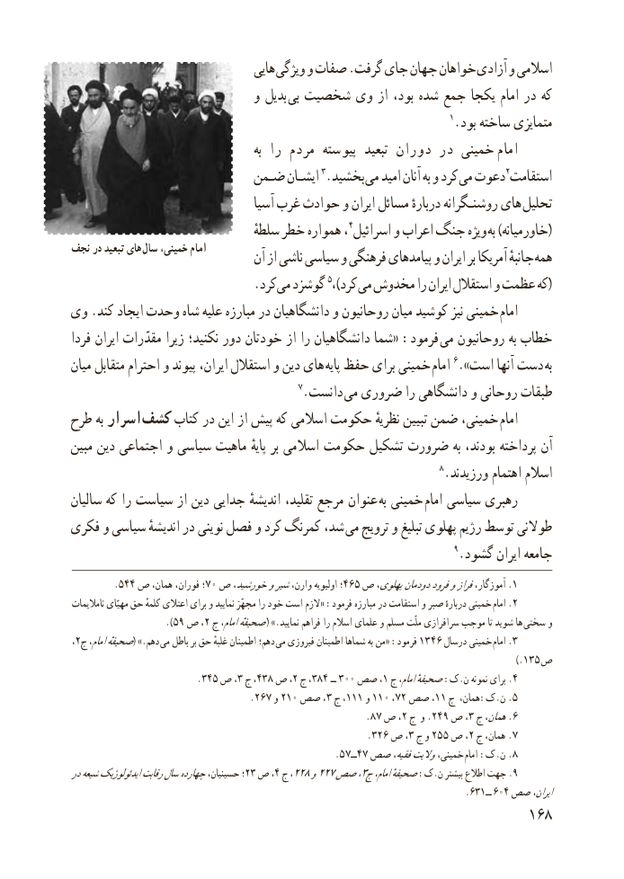

# PDF page 176

هایی ویژگی و صفات .گرفت جای جهان خواهان آزادی و اسالمی
                              و بدیل  بی شخصیت وی از بود، شده جمع یکجا امام در که
                                                                      1.بود ساخته متمایزی
                                               به را مردم پیوسته  تبعید دوران در خمینی  امام
                        ضـمن ایشـان 3.بخشید می امید آنان به و کرد می دعوت2استقامت
                                    آسیا غرب حوادث و ایران مسائل دربارهٔ روشنـگرانه های تحلیل
                                    سلطهٔ خطر همواره ،4اسرائیل و اعراب جنگ ویژه (به )خاورمیانه
نجف در تبعید های سال خمینی، امام                                 آن از ناشی سیاسی و فرهنگی پیامدهای و ایران بر آمریکا جانبهٔ همه
                             .کردمی​  گوشزد 5،)کرد (می مخدوش را ایران استقالل و عظمت که
وی .کند ایجاد وحدت شاه علیه مبارزه در دانشگاهیان و روحانیون میان کوشید نیز خمینی  امام
فردا ایران مقدّرات زیرا نکنید؛ دور خودتان از را دانشگاهیان شما« :فرمود می روحانیون به خطاب
میان متقابل احترام و پیوند ایران، استقالل و دین های  پایه حفظ برای خمینی  امام 6.»است آنها دست به
                                          7.دانست می ضروری را دانشگاهی و روحانی طبقات
طرح به اسرار  کشف کتاب در این از پیش که اسالمی حکومت نظریهٔ تبیین ضمن خمینی،  امام
مبین دین اجتماعی و سیاسی ماهیت پایهٔ بر اسالمی حکومت تشکیل ضرورت به بودند، پرداخته آن
                                                                    8.ورزیدند اهتمام اسالم
سالیان که را سیاست از دین جدایی اندیشهٔ تقلید، مرجع عنوان به خمینی امام سیاسی رهبری
فکری و سیاسی اندیشهٔ در نوینی فصل و کرد کمرنگ شد،  می ترویج و تبلیغ پهلوی رژیم توسط طوالنی
                                                                      9.گشود ایران جامعه
        .544 ص همان، فوران، ؛70 ص خورشید،وشیروارن، اولیویه ؛465 ص پهلوی،دودمانفرودوفرازآموزگار، .1
 نامالیمات مهیّای حق کلمهٔ اعتالی برای و نمایید مجهّز را خود است الزم« :فرمود مبارزه در استقامت و صبر دربارهٔ خمینی  .امام 2
                    .)59 ص ،2 ج امام،صحیفهٔ ( ».نمایید فراهم را اسالم علمای و مسلم ملّت سرافرازی موجب تا شوید ها سختی و
 ،2ج امام،صحیفهٔ( .»دهم  می باطل بر حق غلبهٔ اطمینان دهم؛  می فیروزی اطمینان شماها به من« :فرمود 1346 درسال خمینی  3.امام
                                                                                                    ).135 ص
                         .345 ص ،3 ج ،438 ص ،2 ج ،384 ــ 300 صص ،1 ج امام،صحیفهٔ:ک.ن نمونه برای .4
                                  .267 و 210 صص ،3 ج ،111 و 110 ،72 صص ،11 ج همان،:ک.ن .5
                                                        .87 ص ،2 ج و .249 ص ،3 ج همان،6.
                                                       .326 ص ،3 ج و 255 ص ،2 ج همان، 7.
                                                           .٥ــ٧٤خمینی،٧ صص فقیه،والیت  8.امام :ک.ن
درشیعهایدئولوژیکرقابتسالچهاردهحسینیان، ؛23 ص ، 4 ج٢٢، ٨٢٢و ٧صصج٣،امام،صحیفهٔ:ک.ن بیشتر اطالع جهت 9.
                                                                              .631ــ 604 صص ایران،
                                                          186

