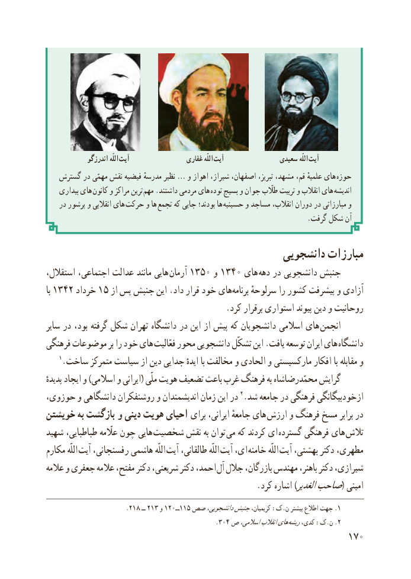

# PDF page 178

اندرزگو اللّه  آیت                  غفاری اللّه آیت               سعیدی اللّه  آیت
   گسترش در مهمّی نقش فیضیه مدرسهٔ نظیر … و اهواز شیراز، اصفهان، تبریز، مشهد، قم، علمیهٔ های  حوزه
    بیداری های کانون و مراکز ترین  مهم .داشتند مردمی های توده بسیج و جوان طااّلّب تربیت و انقالب های  اندیشه
    در پرشور و انقالبی های حرکت و ها تجمع که جایی بودند؛ ها حسینیه و مساجد انقالب، دوران در مبارزاتی و
                                                                          .گرفت شکل آن

                                             دانشجویی مبارزات
استقالل، اجتماعی، عدالت مانند هایی آرمان١٣٥٠١٣٤هایو    ٠         دهه در دانشجویی جنبش
با 1342 خرداد 15 از پس جنبش این .داد قرار خود های ​برنامه سرلوحهٔ را کشور پیشرفت و آزادی
                                           .کرد برقرار استواری پیوند دین و روحانیت
سایر در بود، گرفته شکل تهران دانشگاه در این از پیش که دانشجویان اسالمی های  انجمن
فرهنگی موضوعات بر را خود های فعّالیت محور دانشجویی تشکّل این .یافت توسعه ایران های دانشگاه
    1.ساخت متمرکز سیاست از دین جدایی ایدهٔ با مخالفت و الحادی و مارکسیستی افکار با مقابله و
پدیدهٔ ایجاد و )اسالمی و ایرانی( ملّی هویت تضعیف باعث غرب فرهنگ به محمّدرضاشاه گرایش
حوزوی، و دانشگاهی روشنفکران و اندیشمندان زمان این در 2.شد جامعه در فرهنگی ازخودبیگانگی
خویشتن به بازگشت و دینی هویت احیای برای ایرانی، جامعهٔ های  ارزش و فرهنگ مسخ برابر در
شهید طباطبایی، عااّلّمه چون هایی شخصیت نقش به توان  می که کردند ای گسترده فرهنگی های تالش
مکارم اللّه آیت رفسنجانی، هاشمی اللّه آیت طالقانی، اللّه آیت ای، خامنه اللّه آیت بهشتی، دکتر مطهری،
عالمه و جعفری عالمه مفتح، دکتر شریعتی، دکتر احمد، آل جالل بازرگان، مهندس باهنر، دکتر شیرازی،
                                                   .کرد اشاره )الغدیرصاحب( امینی
                      .218 ــ 213 و 120ــ115 صص دانشجویی،جنبشکریمیان، :ک.ن بیشتر اطالع جهت .1
                                                .304 ص اسالمی،انقالبهای .ریشه٢کدی، :ک.ن
                                                          107

