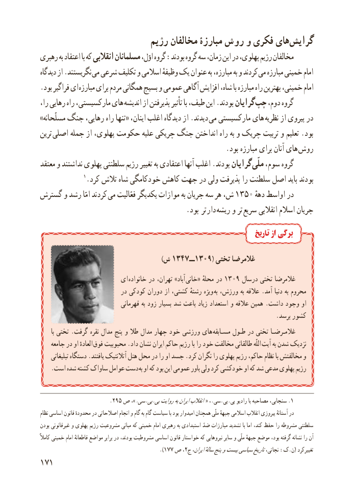

# PDF page 179

رژیم مخالفان مبارزۀ روش و فکری هایگرایش​
رهبری به اعتقاد با که انقالبی مسلمانان اوّل، گروه :بودند گروه سه زمان، این در پهلوی، رژیم مخالفان
دیدگاه از .نگریستند می شرعی تکلیف و اسالمی وظیفهٔ یک عنوان به مبارزه، به و کردند می مبارزه خمینی امام
. بود فراگیر ای مبارزه برای مردم همگانی بسیج و عمومی آگاهی افزایش شاه، با مبارزه راه بهترین خمینی، امام
را، رهایی راه مارکسیستی، های اندیشه از پذیرفتن تأثیر با طیف، این .بودند گرایان چپ دوم، گروه
»مسلّحانه جنگ رهایی، راه تنها« اینان، اغلب دیدگاه از .دیدند  می مارکسیستی های  نظریه از پیروی در
ترین اصلی جمله از پهلوی، حکومت علیه چریکی جنگ انداختن راه به و چریک تربیت و تعلیم .بود
     . بود مبارزه برای آنان های روش
معتقد و نداشتند پهلوی سلطنتی رژیم تغییر به اعتقادی آنها اغلب .بودند گرایان ملّی سوم، گروه
              1.کرد تالش شاه خودکامگی کاهش جهت در ولی پذیرفت را سلطنت اصل باید بودند
گسترش و رشد امّا کردند می فعّالیت یکدیگر موازات به جریان سه هر ش، 1350 دههٔدراواسط
                  . بود تر دار ریشه و تر سریع انقالبی اسالم جریان
                                                                           تاریخ از برگی

                                                          )ش 1347 ــ1309( تختی غالمرضا
                       ای خانواده در تهران، »آباد  خانی« محلهٔ در 1309 درسال تختی غالمرضا
                           در کودکی دوران از کشتی، رشتهٔ ویژه  به ورزش، به عالقه .آمد دنیا به محروم
                               قهرمانی به زود بسیار شد باعث زیاد استعداد و عالقه همین .داشت وجود او
                                                                             .برسد کشور
       با تختی .گرفت نقره مدال پنج و طال مدال چهار خود ورزشی های  مسـابقه طـول در تختی غالمـرضـا
    جامعه در او العادهٔ فوق محبوبیت .داد نشان ایران حاکم رژیم با را خود مخالفت طالقانی اللّه آیت به شدن نزدیک
     تبلیغاتی دستگاه .یافتند آتالنتیک هتل محل در را او جسد .کرد نگران را پهلوی رژیم حاکم، نظام با مخالفتش و
. است شده کشته ساواک عوامل دست به او که بود این عمومی باور ولی کرد خودکشی او که شد مدعی پهلوی رژیم

                       .295 ص ،» .سی.بی.بیروایتبهایرانانقالب « ،..سی.بی.بی رادیو با مصاحبه سنجابی، 1
نظام اساسی قانون محدودهٔ در اصالحاتی انجام و گام  به   گام سیاست با بود امیدوار همچنان ملّی جبههٔ اسالمی انقالب پیروزی آستانهٔ در
بودن غیرقانونی و پهلوی رژیم مشروعیت مبانی که خمینی امام رهبری به استبدادی ضدّ مبارزات تشدید با اما کند، حفظ را مشروطه سلطنتی
کامالً خمینی امام قاطعانهٔ مواضع برابر در بودند، مشروطیت اساسی قانون خواستار که نیروهایی سایر و ملّی جبههٔ موضع بود، گرفته نشانه را آن
                                           ).177 ص ،2ج ایران،سالهٔپنجوبیستسیاسیتاریخنجاتی، :ک.ن( تغییرکرد
171

