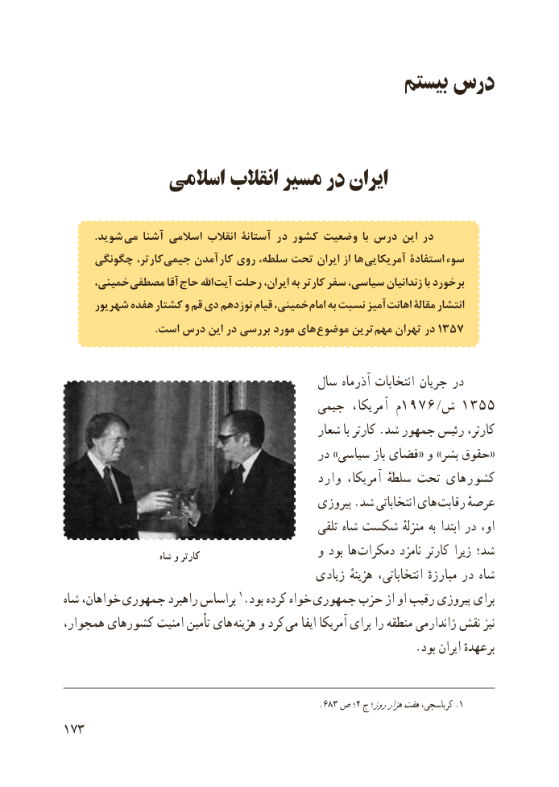

# PDF page 181

بیستم درس

           اسالمی انقالب مسیر در ایران

            . شوید  می آشنا اسالمی انقالب آستانۀ در کشور وضعیت  با درس این در
     چگونگی کارتر، جیمی آمدن  کار روی سلطه، تحت ایران از ها آمریکایی استفادة سوء
     خمینی، مصطفی آقا حاج اهلل آیت رحلت ایران، به کارتر سفر سیاسی، زندانیان با برخورد
     شهریور هفده کشتار و قم دی نوزدهم قیام خمینی، امام به نسبت آمیز اهانت مقالة انتشار
 . است درس این در بررسی مورد های موضوع ترین مهم تهران در ٧٥٣١

                                        سال آذرماه انتخابات جریان در
                                      جیمی  آمریکا،  م1976/ ش 1355
                                             شعار با کارتر .شد جمهور رئیس کارتر،
                                            در »سیاسی باز فضای« و »بشر حقوق«
                                            وارد آمریکا، سلطهٔ تحت کشورهای
                                             پیروزی .شد انتخاباتی های رقابت عرصهٔ
                                                    تلقی شاه شکست منزلهٔ به ابتدا در او،
                        شاه و کارتر                    و بود ها  دمکرات نامزد کارتر زیرا شد؛
                                            زیادی هزینهٔ انتخاباتی، مبارزهٔ در شاه
شاه خواهان،  جمهوری راهبرد براساس 1.بود کرده خواه جمهوری حزب از او رقیب پیروزی برای
همجوار، کشورهای امنیت تأمین های  هزینه و کرد می ایفا آمریکا برای را منطقه ژاندارمی نقش نیز
                                                            .بود ایران برعهدهٔ

                                                     .683 ص ؛2 ج روز؛هزارهفتکرباسچی، .1
173

