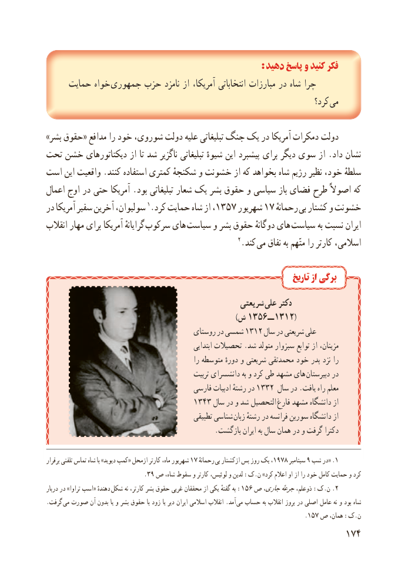

# PDF page 182

: دهید پاسخ و کنید فکر
     حمایت خواه جمهوری حزب نامزد از آمریکا، انتخاباتی مبارزات در شاه چرا
                                                                          کرد؟  می

»بشر حقوق« مدافع را خود شوروی، دولت علیه تبلیغاتی جنگ یک در آمریکا دمکرات دولت
تحت خشن دیکتاتورهای از تا شد ناگزیر تبلیغاتی شیوهٔ این پیشبرد برای دیگر سوی از .داد نشان
است این واقعیت .کنند استفاده کمتری شکنجهٔ و خشونت از که بخواهد شاه رژیم نظیر خود، سلطهٔ
اعمال اوج در حتی آمریکا .بود تبلیغاتی شعار یک بشر حقوق و سیاسی باز فضای طرح اصوالً که
در آمریکا سفیر آخرین سولیوان، 1.کرد حمایت شاه از ،1357 شهریور 17 ٔرحمانه بی کشتار و خشونت
انقالب مهار برای آمریکا گرایانهٔ  سرکوب های  سیاست و بشر حقوق دوگانهٔ های  سیاست به نسبت ایران
                                                      2.کند می نفاق به متّهم را کارتر اسالمی،

                                                                          تاریخ از برگی
                                                 شریعتی علی دکتر
         ) (ش ــ٦٥٣١ ٢١٣١
                                        روستای در شمسی 1312 سال در شریعتی علی
                                                        ابتدایی تحصیالت .شد متولد سبزوار توابع از مزینان،
                                                    را متوسطه دورهٔ و شریعتی محمدتقی خود پدر نزد را
                                                تربیت دانشسرای به و کرد طی مشهد های  دبیرستان در
                                         فارسی ادبیات رشتهٔ در 1332 سال در .یافت راه معلم
                                 1343 سال در و شد التحصیل فارغ مشهد دانشگاه از
                                               تطبیقی شناسی زبان رشتهٔ در فرانسه سوربن دانشگاه از
                                                .بازگشت ایران به سال همان در و گرفت دکترا

برقرار تلفنی تماس شاه با »دیوید کمپ« ازمحل کارتر ماه، شهریور 17 ٔرحمانه  بی ازکشتار پس روز یک ،1978 سپتامبر 9 شب در« .1
                             .39 ص شاه، سقوط و کارتر لوئیس، و لدین :ک.ن »کرد اعالم او از را خود کامل حمایت و کرد
دربار در »تراوا اسب« دهندهٔ :شکل نه کارتر، بشر حقوق غربی محققان از یکی گفتهٔ به 156 ص جاری،جرعهٔذوعلم، :ک.ن .2
.گرفت می صورت آن بدون یا و بشر حقوق با زود یا دیر ایران اسالمی انقالب .آمد می حساب به انقالب بروز در اصلی عامل نه و بود شاه
                                                                         .157 ص همان، :ک.ن
                                                          174

