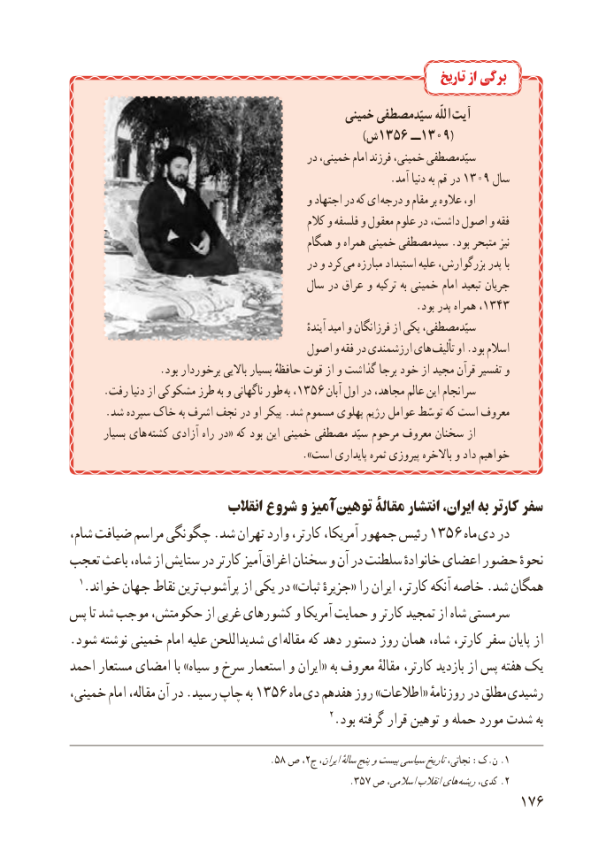

# PDF page 184

تاریخ از برگی
                                                خمینی سیّدمصطفی اللّه آیت
                                )1356ش       ــ 1309(
                                              در خمینی، امام فرزند خمینی، سیّدمصطفی
                .1309آمد دنیا به قم در      سال
                                             و اجتهاد در که ای درجه و مقام بر عالوه او،
                                                     کالم و فلسفه و معقول علوم در داشت، اصول و فقه
                                               همگام و همراه خمینی سیدمصطفی .بود متبحر نیز
                                              در و کرد می مبارزه استبداد علیه بزرگوارش، پدر با
                                          سال در عراق و ترکیه به خمینی امام تبعید جریان
                                                                 .بود پدر همراه ،1343
               ٔسیّدمصطفی،آینده امید و فرزانگان از یکی
                                      اصول و فقه در ارزشمندی های تألیف او .بود اسالم
                 .بود برخوردار باالیی بسیار حافظهٔ قوت از و گذاشت برجا خود از مجید قرآن تفسیر و
      .رفت دنیا از مشکوکی طرز به و ناگهانی طور  به ،1356 آبان اول در مجاهد، عالم این سرانجام
       .شد سپرده خاک به اشرف نجف در او پیکر .شد مسموم پهلوی رژیم عوامل توسّط که است معروف
        بسیار های کشته آزادی راه در« که بود این خمینی مصطفی سیّد مرحوم معروف سخنان از
                                                ».است پایداری ثمره پیروزی باالخره و داد خواهیم

                            انقالب شروع و آمیز توهین مقالۀ انتشار ایران، به کارتر سفر
شام، ضیافت مراسم چگونگی .شد تهران وارد کارتر، آمریکا، جمهور رئیس 1356 ماه دی در
تعجب باعث شاه، از ستایش در کارتر آمیز اغراق سخنان و آن در سلطنت خانوادهٔ اعضای حضور نحوهٔ
  1.خواند جهان نقاط ترین پرآشوب از یکی در »ثبات جزیرهٔ« را ایران کارتر، آنکه خاصه .شد همگان
پس تا شد موجب حکومتش، از غربی کشورهای و آمریکا حمایت و کارتر تمجید از شاه سرمستی
.شود نوشته خمینی امام علیه شدیداللحن ای مقاله که دهد دستور روز همان شاه، کارتر، سفر پایان از
احمد مستعار امضای با »سیاه و سرخ استعمار و ایران« به معروف مقالهٔ کارتر، بازدید از پس هفته یک
خمینی، امام مقاله، آن در .رسید چاپ به 1356 ماه دی هفدهم روز »اطالعات« روزنامهٔ در مطلق رشیدی
                                                2.بود گرفته قرار توهین و حمله مورد شدت به

                                       .58 ص ،2.ج ایران،سالهٔپنجوبیستسیاسیتاریخنجاتی، :ک.ن 1
                                                     .357 ص اسالمی،انقالبهای .ریشهکدی، 2
                                                          176

