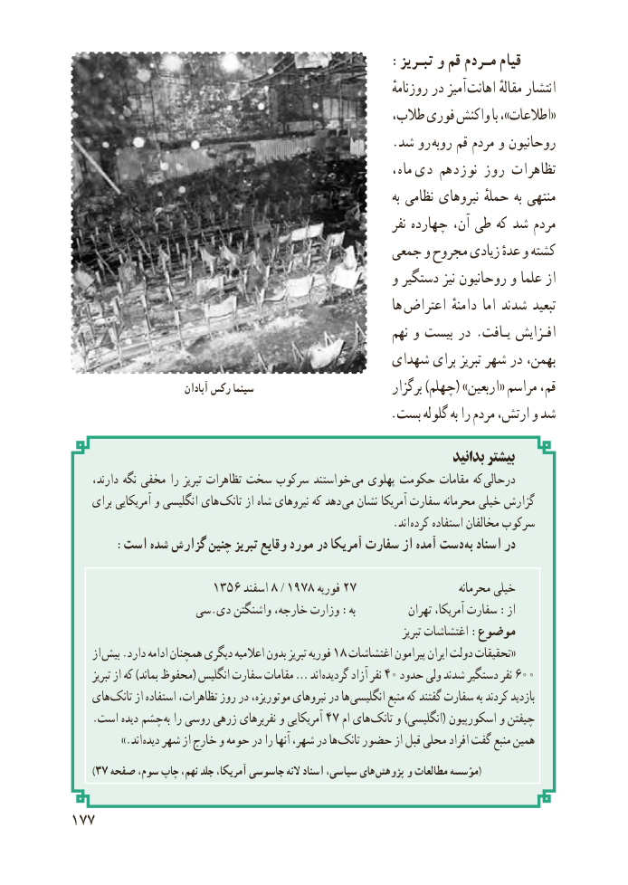

# PDF page 185

:تبـریز و قم مـردم قیام
                                                                       روزنامهٔ در آمیز اهانت مقالهٔ انتشار
                                                 طالب، فوری واکنش با ،»اطالعات«
                                                   .شد رو روبه قم مردم و روحانیون
                                                                ماه،  دی نوزدهم روز تظاهرات
                                                                                 به نظامی نیروهای حملهٔ به منتهی
                                                                      نفر چهارده آن، طی که شد مردم
                                           جمعی و مجروح زیادی عدهٔ و کشته
                                                   و دستگیر نیز روحانیون و علما از
                                                                ها  اعتراض دامنهٔ اما شدند تبعید
                                                            نهم و بیست در . یـافت افـزایش
                                           شهدای برای تبریز شهر در بهمن،
                            آبادان رکس سینما                           برگزار )چهلم( »اربعین« مراسم قم،
                                                  .بست گلوله به را مردم ارتش، و شد
                                                                        بدانید بیشتر
     دارند، نگه مخفی را تبریز تظاهرات سخت سرکوب خواستند  می پهلوی حکومت مقامات که  درحالی
    برای آمریکایی و انگلیسی های تانک از شاه نیروهای که دهد  می نشان آمریکا سفارت محرمانه خیلی گزارش
                                 . اند کرده استفاده مخالفان سرکوب
       :است شده گزارش چنین تبریز وقایع مورد در آمریکا سفارت از آمده دست به اسناد در

                     ١٣٥٦ اسفند١٩٧٨ / ٨٢٧فوریه                          محرمانه خیلی
                 سی.دی واشنگتن خارجه، وزارت :به           تهران آمریکا، سفارت :از
                                                                                         تبریز اغتشاشات :موضوع
     از بیش١.دارد ادامه همچنان دیگری اعالمیه بدون تبریز فوریه ٨ اغتشاشات پیرامون ایران دولت تحقیقات«
      تبریز از که )بماند محفوظ( انگلیس سفارت مقامات … اند گردیده٤آزاد نفر ٠٦٠٠حدود ولی شدند دستگیر نفر
    های تانک از استفاده تظاهرات، روز در موتوریزه، نیروهای در ها انگلیسی منبع که گفتند سفارت به کردند بازدید
    .است دیده چشم به٤٧را روسی زرهی نفربرهای و آمریکایی     ام های تانک و )انگلیسی( اسکورپیون و چیفتن
          .»اند دیده شهر از خارج و حومه در را آنها شهر، در ها تانک حضور از قبل محلی افراد گفت منبع همین
       )٧٣ صفحه سوم، چاپ نهم، جلد آمریکا، جاسوسی النه اسناد سیاسی، های (پژوهش و مطالعات مؤسسه

177

