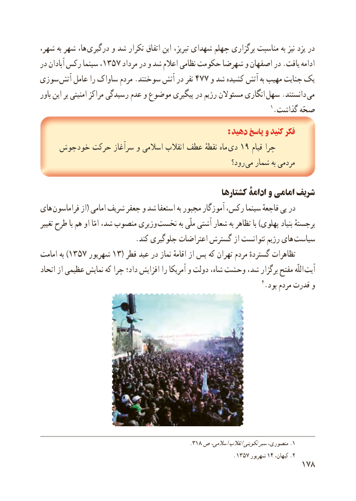

# PDF page 186

،ها،شهر به شهر       درگیری و شد تکرار اتفاق این تبریز، شهدای چهلم برگزاری مناسبت به نیز یزد در
در آبادان رکس سینما ،١٣٥٧ مرداد در و شد اعالم نظامی حکومت شهرضا و اصفهان در .یافت ادامه
سوزی  آتش عامل را ساواک مردم .سوختند آتش در نفر 477 و شد کشیده آتش به مهیب جنایت یک
باور این بر امنیتی مراکز رسیدگی عدم و موضوع پیگیری در رژیم مسئوالن انگاری سهل .دانستند  می
                                                                          1.گذاشت صحّه
                                                                  : دهید پاسخ و کنید فکر
   جوش خود حرکت سرآغاز و اسالمی انقالب عطف نقطهٔ ماه  دی١چرا٩ قیام
                                                          رود؟ می شمار به مردمی

                                                  کشتارها ادامۀ و امامی شریف
های فراماسون از( امامی شریف جعفر و شد استعفا به مجبور آموزگار رکس، سینما فاجعهٔ پی در
تغییر طرح با هم او امّا شد، منصوب وزیری نخست به ملّی آشتی شعار به تظاهر با )پهلوی بنیاد برجستهٔ
                           .کند جلوگیری اعتراضات گسترش از نتوانست رژیم های سیاست
امامت به )١٣٥٧ شهریور١٣ ( فطر عید در نماز اقامهٔ از پس که تهران مردم گستردهٔ تظاهرات
اتحاد از عظیمی نمایش که چرا داد؛ افزایش را آمریکا و دولت شاه، وحشت شد، برگزار مفتح اللّه آیت
                                                                       2.بود مردم قدرت و

                                                 .318 ص اسالمی،انقالبتکوینیسیرمنصوری، .1
                                                                         . 1357 شهریور 14 ،کیهان .2
                                                          178

