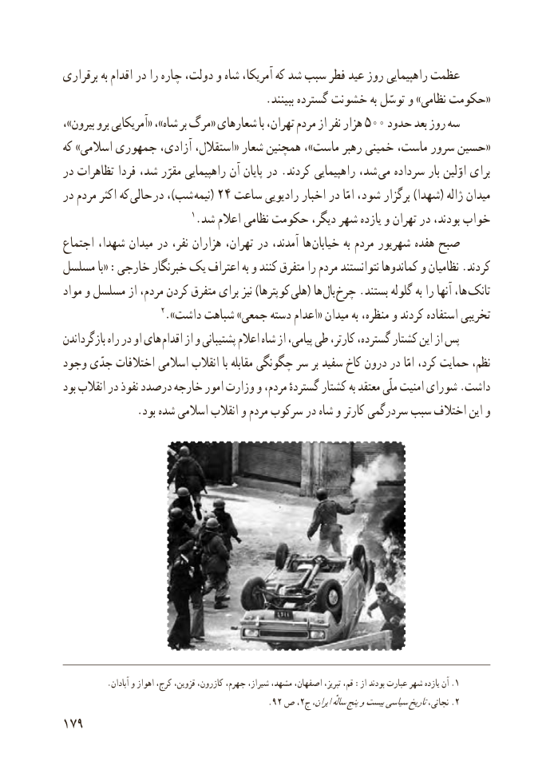

# PDF page 187

برقراری به اقدام در را چاره دولت، و شاه آمریکا، که شد سبب فطر عید روز راهپیمایی عظمت
                                    .ببینند گسترده خشونت به توسّل و »نظامی حکومت«
،»بیرون برو آمریکایی« ،»شاه بر مرگ« شعارهای با تهران، مردم از نفر هزار ٥سه٠٠ حدود بعد روز
که »اسالمی جمهوری آزادی، استقالل،« شعار همچنین ،»ماست رهبر خمینی ماست، سرور حسین«
در تظاهرات فردا شد، مقرّر راهپیمایی آن پایان در .کردند راهپیمایی شد، می سرداده بار اوّلین برای
در مردم اکثر که  حالی در ،)شب نیمه( 24 ساعت رادیویی اخبار در امّا شود، برگزار )شهدا( ژاله میدان
                           1.شد اعالم نظامی حکومت دیگر، شهر یازده و تهران در بودند، خواب
اجتماع شهدا، میدان در نفر، هزاران تهران، در آمدند، ها خیابان به مردم شهریور هفده صبح
مسلسل با« :خارجی خبرنگار یک اعتراف به و کنند متفرق را مردم نتوانستند کماندوها و نظامیان .کردند
مواد و مسلسل از مردم، کردن متفرق برای نیز )کوپترها هلی( ها بال چرخ .بستند گلوله به را آنها ها،  تانک
                     2.»داشت شباهت »جمعی دسته اعدام« میدان به منظره، و کردند استفاده تخریبی
بازگرداندن راه در او های اقدام از و پشتیبانی اعالم شاه از پیامی، طی کارتر، گسترده، کشتار این از پس
وجود جدّی اختالفات اسالمی انقالب با مقابله چگونگی سر بر سفید کاخ درون در امّا کرد، حمایت نظم،
بود انقالب در نفوذ درصدد خارجه امور وزارت و مردم، گستردهٔ کشتار به معتقد ملّی امنیت شورای .داشت
              .بود شده اسالمی انقالب و مردم سرکوب در شاه و کارتر سردرگمی سبب اختالف این و

..آبادان و اهواز کرج، قزوین، کازرون، جهرم، شیراز، مشهد، اصفهان، تبریز، قم، :از بودند عبارت شهر یازده آن 1
                                            .92 ص ،2.ج ایران،سالهٔپنجوبیستسیاسیتاریخنجاتی، 2
179

