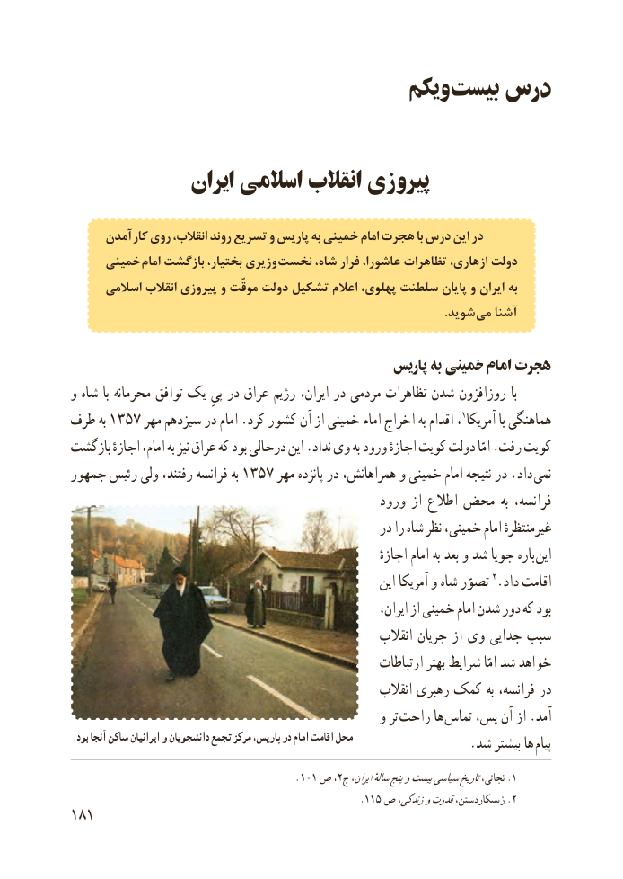

# PDF page 189

ویکم بیست درس

              ایران اسالمی انقالب پیروزی

     آمدن کار روی انقالب، روند تسریع و پاریس به خمینی امام هجرت با درس این در
     خمینی امام بازگشت بختیار، وزیری نخست شاه، فرار عاشورا، تظاهرات ازهاری، دولت
      اسالمی انقالب پیروزی و موقّت دولت تشکیل اعالم پهلوی، سلطنت پایان و ایران به
                                                                                                                             .شوید می آشنا

                                                پاریس به خمینی امام هجرت
و شاه با محرمانه توافق یک پیِ در عراق رژیم ایران، در مردمی تظاهرات شدن روزافزون با
طرف به 1357 مهر سیزدهم در امام .کرد کشور آن از خمینی امام اخراج به اقدام ،1آمریکا با هماهنگی
بازگشت اجازهٔ امام، به نیز عراق که بود درحالی این .نداد وی به ورود اجازهٔ کویت دولت امّا .رفت کویت
جمهور رئیس ولی رفتند، فرانسه به 1357 مهر پانزده در همراهانش، و خمینی امام نتیجه در .داد  نمی
                                                ورود از اطالع محض به فرانسه،
                                                  در را شاه نظر خمینی، امام غیرمنتظرهٔ
                                                                    اجازهٔ امام به بعد و شد جویا باره  این
                                                           این آمریکا و شاه تصوّر 2.داد اقامت
                                                                  ایران، از خمینی امام شدن دور که بود
                                                         انقالب جریان از وی جدایی سبب
                                                         ارتباطات بهتر شرایط امّا شد خواهد
                                                         انقالب رهبری کمک به فرانسه، در
                                                  و تر  راحت ها تماس پس، آن از .آمد
.بود آنجا ساکن ایرانیان و دانشجویان تجمع مرکز پاریس، در امام اقامت محل                   .شد بیشتر ها پیام
                                                  . 101 ص ،2.ج ایران،سالهٔپنجوبیستسیاسیتاریخنجاتی، 1
                                                      .115 ص زندگی،وقدرتژیسکاردستن، .2
181

