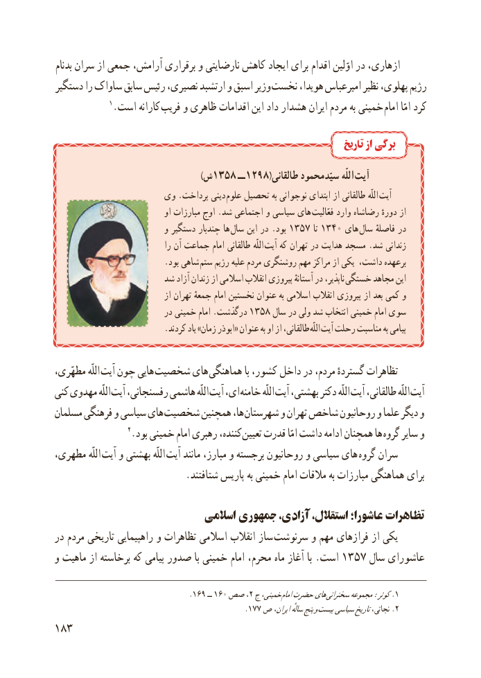

# PDF page 191

بدنام سران از جمعی آرامش، برقراری و نارضایتی کاهش ایجاد برای اقدام اوّلین در ازهاری،
دستگیر را ساواک سابق رئیس نصیری، ارتشبد و اسبق وزیر نخست هویدا، امیرعباس نظیر پهلوی، رژیم
               ١.است کارانه فریب و ظاهری اقدامات این داد هشدار ایران مردم به خمینی امام امّا کرد

                                                                          تاریخ از برگی

                                                   )٨٥٣١ش  ــ ٨٩٢١ (طالقانی محمود سیّد اللّه آیت
                   وی .پرداخت دینی  علوم تحصیل به نوجوانی ابتدای از طالقانی اللّه آیت
                                 او مبارزات اوج .شد اجتماعی و سیاسی های  فعّالیت وارد رضاشاه دورهٔ از
                           و دستگیر چندبار ها سال این در .بود 1357 تا 1340 های سال فاصلهٔ در
                                 را آن جماعت امام طالقانی اللّه آیت که تهران در هدایت مسجد .شد زندانی
                          .بود شاهی  ستم رژیم علیه مردم روشنگری مهم مراکز از یکی داشت، برعهده
                     شد آزاد زندان از اسالمی انقالب پیروزی آستانهٔ در ناپذیر،  خستگی مجاهد این
                                 از تهران جمعهٔ امام نخستین عنوان به اسالمی انقالب پیروزی از بعد کمی و
                           در خمینی امام .درگذشت 1358 سال در ولی شد انتخاب خمینی امام سوی
                          .کردند یاد »زمان ابوذر« عنوان به او از طالقانی،  اللّه آیت رحلت مناسبت به پیامی

،اللّهمطهّری       آیت چون هایی شخصیت های هماهنگی با کشور، داخل در مردم، گستردهٔ تظاهرات
کنی مهدوی اللّه آیت رفسنجانی، هاشمی اللّه آیت ای، خامنه اللّه آیت بهشتی، دکتر اللّه آیت طالقانی، اللّه آیت
مسلمان فرهنگی و سیاسی های شخصیت همچنین ها، شهرستان و تهران شاخص روحانیون و علما دیگر و
                    ٢.بود خمینی امام رهبری کننده، تعیین قدرت امّا داشت ادامه همچنان ها گروه سایر و
مطهری، اللّه  آیت و بهشتی اللّه آیت مانند مبارز، و برجسته روحانیون و سیاسی های  گروه سران
                           .شتافتند پاریس به خمینی امام مالقات به مبارزات هماهنگی برای

                             اسالمی جمهوری آزادی، استقالل، عاشورا؛ تظاهرات
در مردم تاریخی راهپیمایی و تظاهرات اسالمی انقالب ساز سرنوشت و مهم فرازهای از یکی
و ماهیت از برخاسته که پیامی صدور با خمینی امام محرم، ماه آغاز با .است 1357 سال عاشورای

                                       .١٦٩١٦،ــ ٠٢صص  ج خمینی، امامحضرتهای .سخنرانی١مجموعه:کوثر
                                              .177 ص ایران،سالهٔپنج و .بیست٢سیاسیتاریخنجاتی،
183

