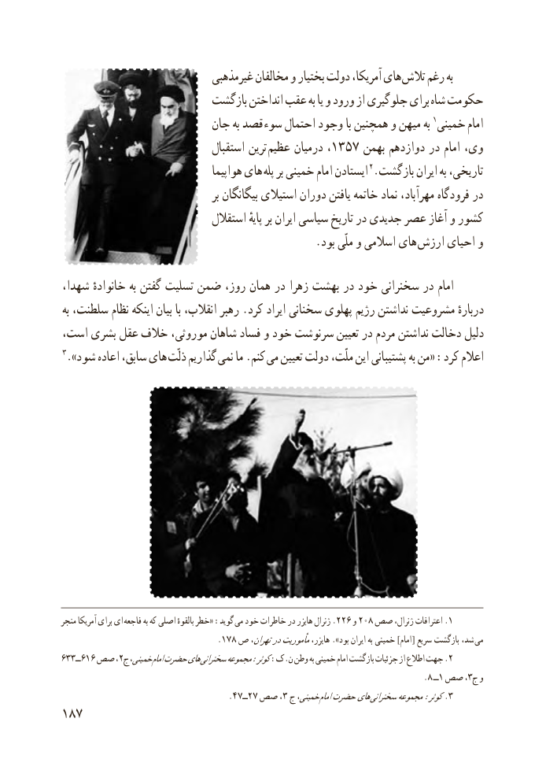

# PDF page 195

غیرمذهبی مخالفان و بختیار دولت آمریکا، های تالش رغم به
                          بازگشت انداختن عقب به یا و ورود از جلوگیری برای شاه حکومت
                         جان به قصد  سوء احتمال وجود با همچنین و میهن به 1خمینی  امام
                                استقبال ترین عظیم درمیان ،1357 بهمن دوازدهم در امام وی،
                                   هواپیما های پله بر خمینی امام ایستادن 2.بازگشت ایران به تاریخی،
                                          بر بیگانگان استیالی دوران یافتن خاتمه نماد مهرآباد، فرودگاه در
                               استقالل پایهٔ بر ایران سیاسی تاریخ در جدیدی عصر آغاز و کشور
                                              .بود ملّی و اسالمی های ارزش احیای و

،امامشهدا خانوادهٔ به گفتن تسلیت ضمن روز، همان در زهرا بهشت در خود سخنرانی در
به سلطنت، نظام اینکه بیان با انقالب، رهبر .کرد ایراد سخنانی پهلوی رژیم نداشتن مشروعیت دربارهٔ
است، بشری عقل خالف موروثی، شاهان فساد و خود سرنوشت تعیین در مردم نداشتن دخالت دلیل
٣.»شود اعاده سابق، های ذلّت گذاریم نمی ما .کنم  می تعیین دولت ملّت، این پشتیبانی به من« :کرد اعالم

منجر آمریکا برای ای  فاجعه به که اصلی بالقوهٔ خطر« :گوید .می خود خاطرات در هایزر ژنرال 226 و 208 صص١ژنرال، اعترافات .
                                 .178 ص تهران،درمأموریتهایزر، ».بود ایران به خمینی ]امام[ سریع بازگشت شد، می
633ــ616 صص ،2ج خمینی، امامحضرتهای .سخنرانی٢مجموعه:کوثر:ک.ن وطن به خمینی امام بازگشت جزئیات از اطالع جهت
                                                                                                      .8 ــ١ صص ،3ج و
                                           . ٤٧ــ٢٧ صص ،3 ج خمینی، امامحضرتهای .سخنرانی٣مجموعه:کوثر
187

