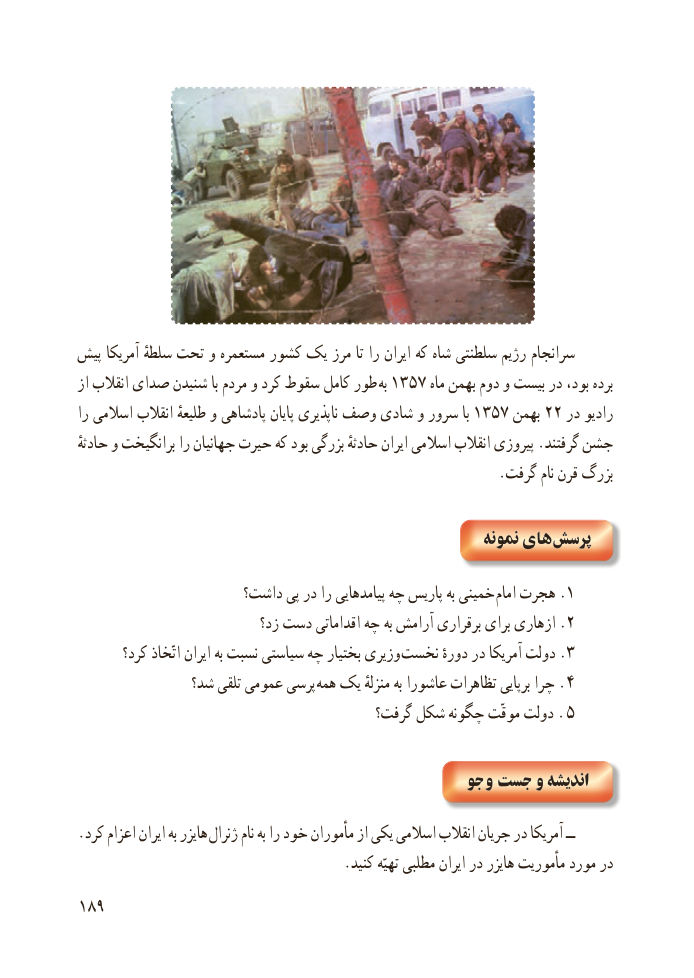

# PDF page 197

پیش آمریکا سلطهٔ تحت و مستعمره کشور یک مرز تا را ایران که شاه سلطنتی رژیم سرانجام
از انقالب صدای شنیدن با مردم و کرد سقوط کامل طور به 1357 ماه بهمن دوم و بیست در بود، برده
را اسالمی انقالب طلیعهٔ و پادشاهی پایان ناپذیری وصف شادی و سرور با 1357 بهمن 22 در رادیو
حادثهٔ و برانگیخت را جهانیان حیرت که بود بزرگی حادثهٔ ایران اسالمی انقالب پیروزی .گرفتند جشن
                                                            .گرفت نام قرن بزرگ

                                                          نمونه های پرسش

                     داشت؟ پی در را پیامدهایی چه پاریس به خمینی .امام١هجرت
  زد؟٢دست اقداماتی چه به آرامش برقراری برای ازهاری .
       کرد؟ اتّخاذ ایران به نسبت سیاستی چه بختیار وزیری .نخست٣دورهٔ در آمریکا دولت
               شد؟ تلقی عمومی پرسی .همه یک منزلهٔ به عاشورا تظاهرات برپایی چرا    ٤
                                         گرفت؟ شکل چگونه موقّت دولت .  ٥

                                               جو و  جست و اندیشه

.کرد اعزام ایران به هایزر ژنرال نام به را خود مأموران از یکی اسالمی انقالب جریان در آمریکا ــ
                                      .کنید تهیّه مطلبی ایران در هایزر مأموریت مورد در
198

