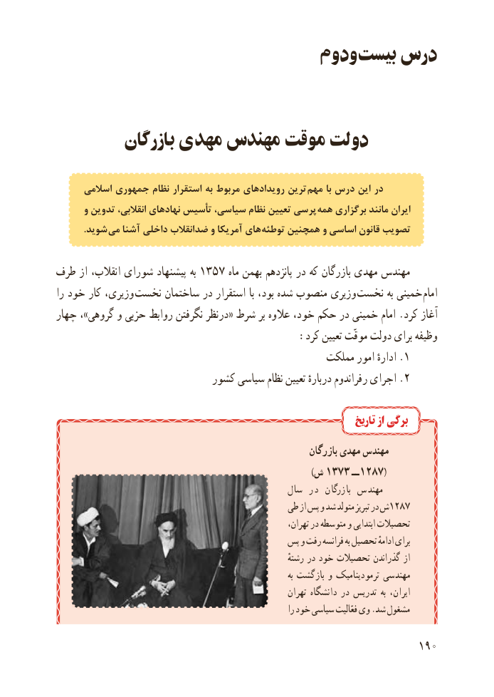

# PDF page 198

ودوم بیست درس

          بازرگان مهدی مهندس موقت دولت

      اسالمی جمهوری نظام استقرار به مربوط رویدادهای ترین مهم با درس این در
      و تدوین انقالبی، نهادهای تأسیس سیاسی، نظام تعیین پرسی همه برگزاری مانند ایران
  . شوید می آشنا داخلی ضدانقالب و آمریکا های  توطئه همچنین و اساسی قانون تصویب

طرف از انقالب، شورای پیشنهاد به 1357 ماه بهمن پانزدهم در که بازرگان مهدی مهندس
را خود کار وزیری، نخست ساختمان در استقرار با بود، شده منصوب وزیری نخست به خمینی امام
چهار ،»گروهی و حزبی روابط نگرفتن درنظر« شرط بر عالوه خود، حکم در خمینی امام .کرد آغاز
                                       :کرد تعیین موقّت دولت برای وظیفه
                                                مملکت امور ادارهٔ .1
                           کشور سیاسی نظام تعیین دربارهٔ رفراندوم اجرای .2

                                                                           تاریخ از برگی
                                                               بازرگان مهدی مهندس
            ) ش ٣٧٣١ ــ  (٧٨٢١
                                               سال در  بازرگان مهندس
                                          طی از پس و شد متولد تبریز در ش1287
               ،تحصیالتتهران در متوسطه و ابتدایی
                                       پس و رفت فرانسه به تحصیل ادامهٔ برای
                                                                       رشتهٔ در خود تحصیالت گذراندن از
                                                                                        به بازگشت و ترمودینامیک مهندسی
                                                              تهران دانشگاه در تدریس به ایران،
                                                                     را خود سیاسی فعّالیت وی .شد مشغول

                                                          190

