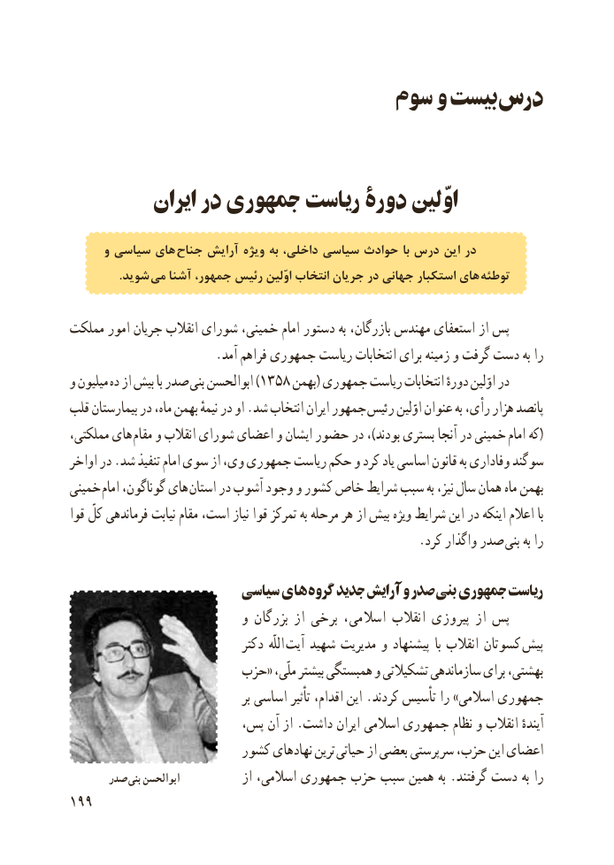

# PDF page 207

سوم و  بىست درس

          ایران در جمهوری رىاست دورۀ اوّلىن

      و سیاسى هاى جناح آرایش ویژه به داخلى، سیاسى حوادث با درس این در
   . شوید مى آشنا جمهور، رئیس اوّلین انتخاب جریان در جهانى استکبار هاى توطئه

مملکت امور جرىان انقالب شوراى خمىنى، امام دستور به بازرگان، مهندس استعفاى از پس
                        .آمد فراهم جمهورى رىاست انتخابات براى زمىنه و گرفت دست به را
و مىلىون ده از بىش با صدر )بنى ابوالحسن 1358 بهمن( جمهوری ریاست انتخابات دورهٔ اوّلین در
قلب بىمارستان در ماه، بهمن نىمهٔ در او .شد انتخاب اىران جمهور  رئىس اوّلىن عنوان به رأى، هزار پانصد
مملکتى، هاى  مقام و انقالب شوراى اعضای و اىشان حضور در ،)بودند بسترى آنجا در خمىنى  (امام که
اواخر در .شد تنفىذ امام سوى از وى، جمهورى رىاست حکم و کرد ىاد اساسى قانون به وفادارى سوگند
خمىنى  امام گوناگون، هاى  استان در آشوب وجود و کشور خاص شراىط سبب به نىز، سال همان ماه بهمن
قوا کلّ فرماندهى نىابت مقام است، نىاز قوا تمرکز به مرحله هر از بىش وىژه شراىط اىن در اىنکه اعالم با
        . کرد واگذار صدر بنى به را

                       سىاسى های گروه جدىد آراىش و صدر بنى جمهوری رىاست
                            و بزرگان از برخى اسالمى، انقالب پىروزى از پس
                                دکتر  اللّه  آىت شهىد مدىرىت و پىشنهاد  با انقالب کسوتان  پىش
                     حزب« ملّى، بىشتر همبستگى و تشکىالتى سازماندهى براى بهشتى،
                                          بر اساسى تأثىر اقدام، اىن .کردند تأسىس را »اسالمى جمهورى
                       پس، آن از .داشت اىران اسالمى جمهورى نظام و انقالب آىندهٔ
                        کشور نهادهاى ترىن حىاتى از بعضى سرپرستى حزب، اىن اعضاى
      صدر بنی ابوالحسن            از اسالمى، جمهورى حزب سبب همىن به .گرفتند دست به را
199

