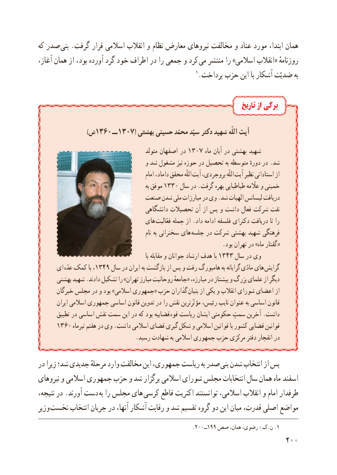

# PDF page 208

که صدر بنى .گرفت قرار اسالمى انقالب و نظام معارض نىروهاى مخالفت و عناد مورد ابتدا، همان
آغاز، همان از بود، آورده گرد خود اطراف در را جمعى و کرد  مى منتشر را »اسالمى انقالب« روزنامهٔ
                                                     1.پرداخت حزب اىن با آشکار ضدىّت به

                                                                          تاریخ از برگی

           )1360 ش      ــ 1307( بهشتى حسىنى محمّد سىّد دکتر شهىد اللّه آیت
                                             متولد اصفهان در 1307 ماه آبان در بهشتى شهىد
                                     و شد مشغول نىز حوزه در تحصىل به متوسطه دورهٔ در .شد
                                                   امام داماد، محقق اللّه آىت بروجردى، اللّه آىت نظىر استادانى از
                                                           به موفق 1330 سال در .گرفت بهره طباطباىى عااّلّمه و خمىنى
                            صنعت شدن ملى مبارزات در وى .شد الهىات لىسانس درىافت
                                      دانشگاهى تحصىالت آن از پس و داشت فعال شرکت نفت
                                 هاى فعّالىت جمله از .داد ادامه فلسفه دکتراى درىافت تا را
                                                          نام به سخنرانى هاى جلسه در شرکت بهشتى شهىد فرهنگى
                                                               .بود تهران در »ماه گفتار«
                                                                       با مقابله و جوانان ارشاد هدف با 1343 سال در وى
     اى  عدّه کمک با ،1349 سال در اىران به بازگشت از پس و رفت هامبورگ به گراىانه مادّى هاى گراىش
      بهشتى شهىد .دادند تشکىل را »تهران مبارز روحانىت جامعهٔ« مبارزه، در پىشتاز و بزرگ علماى از دىگر
       خبرگان مجلس در و بود »اسالمى جمهورى« حزب گذاران بنىان از ىکى و انقالب شوراى اعضاى از
        اىران اسالمى جمهورى اساسى قانون تدوىن در را نقش مؤثّرترىن رئىس، ناىب عنوان به اساسى قانون
       تطبىق در اساسى نقش سمت اىن در که بود قضاىىه قوه رىاست اىشان حکومتى سمتِ آخرىن .داشت
     1360 تىرماه هفتم در وى .داشت اسالمى قضاى گىرى شکل و اسالمى قوانىن با کشور قضاىى قوانىن
                                 .رسىد شهادت به اسالمى جمهورى حزب مرکزى دفتر انفجار در

در زىرا شد؛ جدىدى مرحلهٔ وارد مخالفت اىن جمهورى، رىاست به صدر بنى شدن انتخاب از پس
نىروهاى و اسالمى جمهورى حزب و شد برگزار اسالمى شوراى مجلس انتخابات سال همان ماه   اسفند
نتىجه، در .آورند دست به را مجلس هاى  کرسى قاطع اکثرىت توانستند اسالمى، انقالب و امام طرفدار
وزىر نخست انتخاب جرىان در آنها، آشکار رقابت و شد تقسىم گروه دو اىن مىان قدرت، اصلى مواضع
                                                     .200ــ199 صص همان، رضوی، :ک.ن .1
                                                          200

