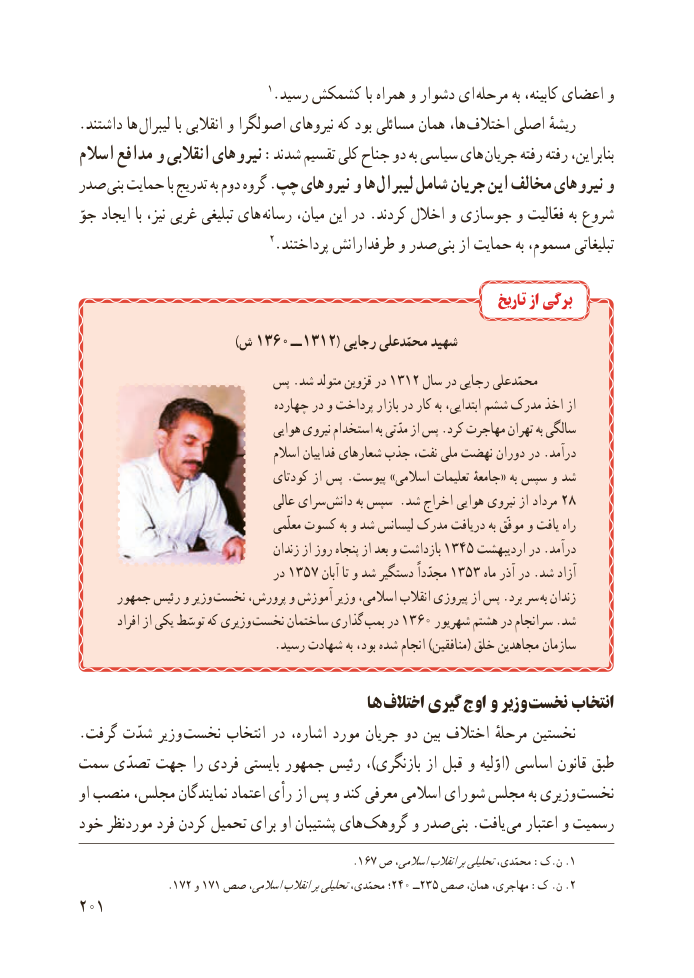

# PDF page 209

1.رسىد کشمکش با همراه و دشوار اى مرحله به کابىنه، اعضاى و
.داشتند ها لىبرال با انقالبى و اصولگرا نىروهاى که بود مسائلى همان ها،  اختالف اصلى رىشهٔ
اسالم مدافع و انقالبى نىروهاى :شدند تقسىم کلى جناح دو به سىاسى هاى جرىان رفته رفته بنابراىن،
صدر بنى حمایت با تدرىج به دوم گروه .چپ نىروهاى و ها لىبرال شامل جرىان اىن مخالف نىروهاى و
جوّ اىجاد با نىز، غربى تبلىغى هاى رسانه مىان، اىن در .کردند اخالل و جوسازى و فعّالىت به شروع
                               2.پرداختند طرفدارانش و صدر بنى از حماىت به مسموم، تبلىغاتى

                                                                          تاریخ از برگی
                                      )ش 1360 ــ 1312( رجاىى محمّدعلى شهىد
                       پس .شد متولد قزوىن در 1312 سال در رجاىى محمّدعلى
                                                               چهارده در و پرداخت بازار در کار به ابتداىى، ششم مدرک اخذ از
                                    هواىى نىروى استخدام به مدّتى از پس .کرد مهاجرت تهران به سالگى
                                     اسالم فداىىان شعارهاى جذب نفت، ملى نهضت دوران در .درآمد
                                 کودتاى از پس .پىوست »اسالمى تعلىمات جامعهٔ« به سپس و شد
                                    عالى سراى دانش به سپس .شد اخراج هواىى نىروى از مرداد 28
                                          معلّمى کسوت به و شد لىسانس مدرک درىافت به موفّق و ىافت راه
                                     زندان از روز پنجاه از بعد و بازداشت 1345 اردىبهشت در .درآمد
                                 در 1357 آبان تا و شد دستگىر مجدّداً 1353 ماه آذر در .شد آزاد
      جمهور رئىس و وزىر نخست پرورش، و آموزش وزىر اسالمى، انقالب پىروزى از پس .برد سر به زندان
        افراد از ىکى توسّط که وزىرى نخست ساختمان گذارى  بمب در 1360 شهرىور هشتم در سرانجام .شد
                                 .رسىد شهادت به بود، شده انجام )منافقىن( خلق مجاهدىن سازمان

                                      ها اختالف گىری اوج و وزىر نخست انتخاب
. گرفت شدّت وزىر  نخست انتخاب در اشاره، مورد جرىان دو بىن اختالف مرحلهٔ نخستىن
سمت تصدّی جهت را فردی باىستى جمهور رئىس ،)بازنگرى از قبل و اوّلىه( اساسى قانون طبق
او منصب مجلس، نمایندگان اعتماد رأی از پس و کند معرفی اسالمی شورای مجلس به وزیری نخست
خود موردنظر فرد کردن تحمیل برای او پشتیبان های  گروهک و صدر بنی .یافت می اعتبار و رسمیت
                                                       .١٦٧ ص اسالمی،انقالببرتحلیلیمحمّدى، :ک.ن .1
                  .١٧٢١٧١و صص٤٠اسالمی،انقالببرتحلیلیمحمّدى، ٢؛   ٥٣٢ــ صص همان، مهاجرى، :ک .ن .2
201

