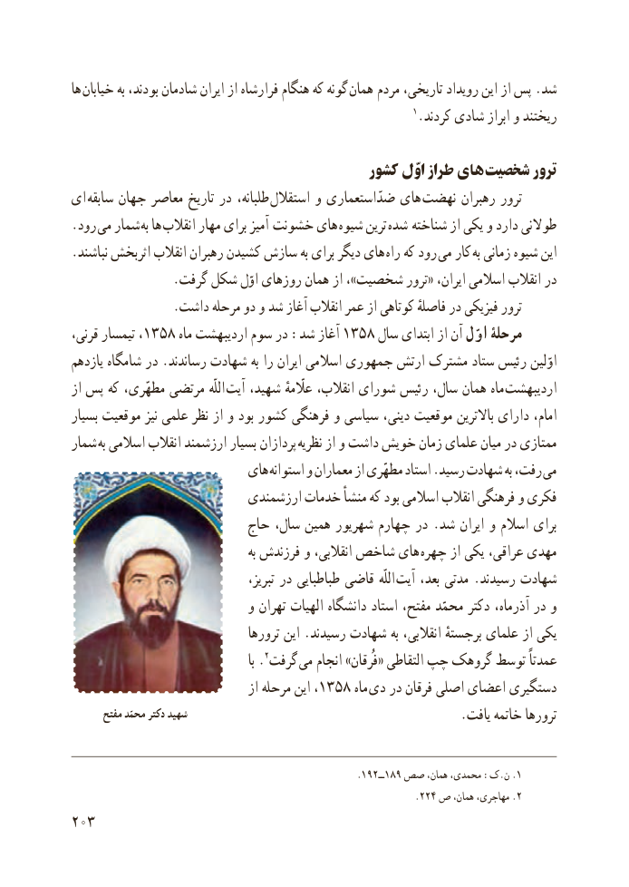

# PDF page 211

ها خىابان به بودند، شادمان اىران از فرارشاه هنگام که گونه  همان مردم تارىخى، روىداد اىن از پس .شد
                                                              1.کردند شادى ابراز و رىختند

                                         کشور اوّل طراز های شخصىت ترور
اى  سابقه جهان معاصر تارىخ در طلبانه،  استقالل و ضدّاستعمارى هاى  نهضت رهبران ترور
.رود مى شمار به ها انقالب مهار براى آمىز  خشونت هاى شىوه ترىن  شده  شناخته از ىکى و دارد طوالنى
.نباشند اثربخش انقالب رهبران کشىدن سازش به براى دىگر هاى راه که رود مى کار به زمانى شىوه اىن
                .گرفت شکل اوّل روزهاى همان از ،»شخصىت ترور« اىران، اسالمى انقالب در
                 .داشت مرحله دو و شد آغاز انقالب عمر از کوتاهى فاصلهٔ در فىزىکى ترور
قرنى، تىمسار ،1358 ماه اردىبهشت سوم در :شد آغاز 1358 سال ابتداى از آن اوّل مرحلۀ
یازدهم شامگاه در .رساندند شهادت به را اىران اسالمى جمهورى ارتش مشترک ستاد رئىس اوّلىن
از پس که مطهّرى، مرتضى اللّه آىت شهىد، عااّلّمهٔ انقالب، شوراى رئىس سال، همان ماه اردىبهشت
بسىار موقعىت نىز علمى نظر از و بود کشور فرهنگى و سىاسى دىنى، موقعىت باالترىن داراى امام،
شمار به اسالمى انقالب ارزشمند بسىار پردازان نظرىه از و داشت خوىش زمان علماى مىان در ممتازى
                          هاى استوانه و معماران از مطهّرى استاد .رسىد شهادت به رفت، مى
                          ارزشمندى خدمات منشأ که بود اسالمى انقالب فرهنگى و فکرى
                         حاج سال، همىن شهرىور چهارم در . شد اىران و اسالم براى
                                             به فرزندش و انقالبى، شاخص هاى چهره از ىکى ،مهدىعراقى
                                        تبرىز، در طباطباىى قاضى  اللّه آىت بعد، مدتى .رسىدند شهادت
                            و تهران الهىات دانشگاه استاد مفتح، محمّد دکتر آذرماه، در و
                                  ترورها اىن .رسىدند شهادت به انقالبى، برجستهٔ علماى از ىکى
                                                      با .2گرفت  مى انجام »فُرقان« التقاطى چپ گروهک توسط عمدتاً
                                   از مرحله اىن ،1358 ماه  دى در فرقان اصلى اعضاى دستگىرى
       مفتح محمّد دکتر شهید                                                             .ىافت خاتمه ترورها

                                                     .192ــ189 صص همان، محمدى، :ک.ن .1
                                                               .224 ص همان، مهاجری، .2
203

