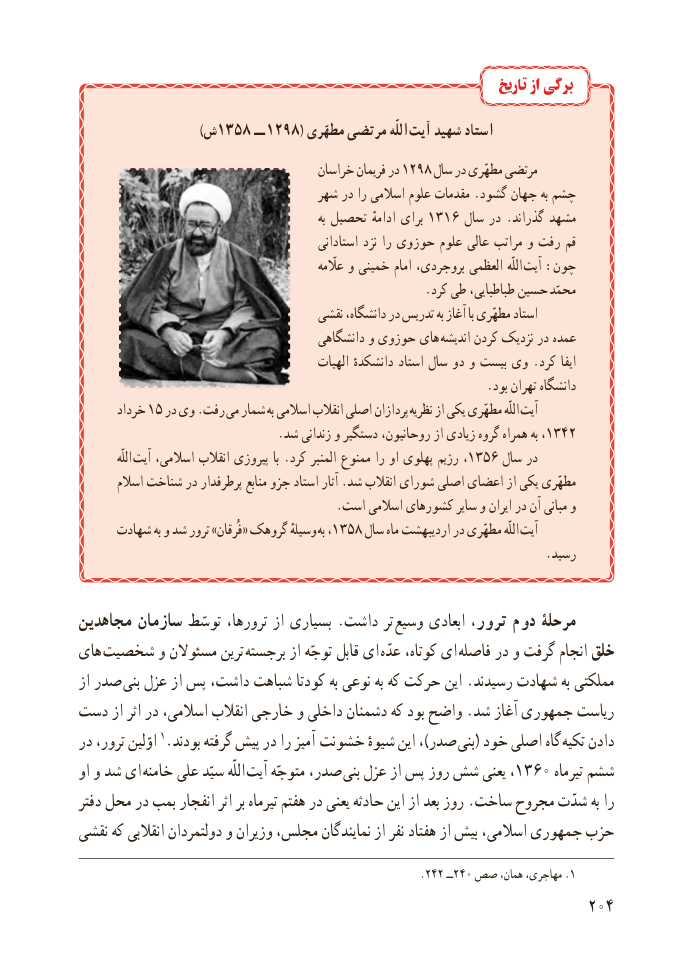

# PDF page 212

تاریخ از برگی

               )1358  ش       ــ 1298( مطهّرى مرتضى اللّه آىت شهىد استاد
                                       خراسان فرىمان در 1298 سال در مطهّرى مرتضى
                                    شهر در را اسالمى علوم مقدمات .گشود جهان به چشم
                                                                به تحصىل ادامهٔ براى 1316 سال در . گذراند مشهد
                                                استادانى نزد را حوزوى علوم عالى مراتب و رفت قم
                                                                           عااّلّمه و خمىنى امام بروجردى، العظمى  اللّه آىت :چون
                                                          .کرد طى طباطباىى، حسىن محمّد
                                      نقشى دانشگاه، در تدرىس به آغاز با مطهّرى استاد
                                         دانشگاهى و حوزوى هاى  اندىشه کردن نزدىک در عمده
                                              الهىات دانشکدهٔ استاد سال دو و بىست وى . کرد اىفا
                                                                    .بود تهران دانشگاه
       خرداد 15 در وى .رفت مى شمار  به اسالمى انقالب اصلى پردازان نظرىه از ىکى مطهّرى اللّه آىت
                                 .شد زندانى و دستگىر روحانىون، از زىادى گروه همراه به ،1342
             اللّه  آىت اسالمى، انقالب پىروزى با .کرد المنبر ممنوع را او پهلوى رژىم ،1356 سال در
       اسالم شناخت در پرطرفدار منابع جزو استاد آثار .شد انقالب شوراى اصلى اعضاى از ىکى مطهّرى
                                           .است اسالمى کشورهاى ساىر و اىران در آن مبانى و
      شهادت به و شد ترور »فُرقان« گروهک وسىلهٔ  به ،1358 سال ماه اردىبهشت در مطهّرى اللّه آىت
                                                                              .رسىد

مجاهدىن سازمان توسّط ترورها، از بسىارى . داشت تر  وسىع ابعادى ترور، دوم مرحلۀ
هاى شخصىت و مسئوالن ترىن برجسته از توجّه قابل اى  عدّه کوتاه، اى فاصله در و گرفت انجام خلق
از صدر بنى عزل از پس داشت، شباهت کودتا به نوعى به که حرکت اىن .رسىدند شهادت به مملکتى
دست از اثر در اسالمى، انقالب خارجى و داخلى دشمنان که بود واضح .شد آغاز جمهورى رىاست
در ترور، اوّلىن 1.بودند گرفته پىش در را آمىز  خشونت شىوهٔ اىن ،)صدر بنى( خود اصلى گاه تکىه دادن
او و شد اى  خامنه على سىّد اللّه آىت متوجّه صدر، بنى عزل از پس روز شش ىعنى ،1360 تىرماه ششم
دفتر محل در بمب انفجار اثر بر تىرماه هفتم در ىعنى حادثه اىن از بعد روز .ساخت مجروح شدّت به را
نقشى که انقالبى دولتمردان و وزىران مجلس، نماىندگان از نفر هفتاد از بىش اسالمى، جمهورى حزب

                                                                    .٢٤٢ــ٢٤٠ صص همان، مهاجری، .1
                                                          204

