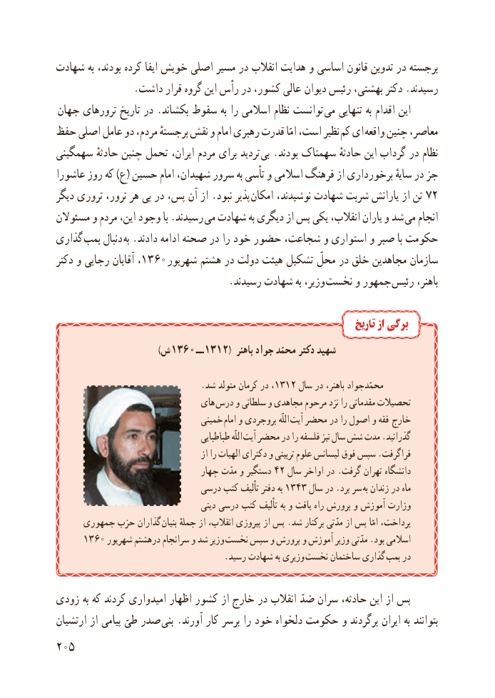

# PDF page 213

شهادت به بودند، کرده اىفا خوىش اصلى مسىر در انقالب هداىت و اساسى قانون تدوىن در برجسته
                .داشت قرار گروه اىن رأس در کشور، عالى   دىوان رئىس بهشتى، دکتر .رسىدند
 جهان ترورهاى تارىخ در .بکشاند سقوط به را اسالمى نظام توانست  مى تنهاىى به اقدام اىن
حفظ اصلى عامل دو مردم، برجستهٔ نقش و امام رهبرى قدرت امّا است، نظىر کم اى واقعه چنىن معاصر،
سهمگىنى حادثهٔ چنىن تحمل اىران، مردم براى تردىد بى .بودند سهمناک حادثهٔ اىن گرداب در نظام
عاشورا روز که )ع( حسىن امام شهىدان، سرور به تأسى و اسالمى فرهنگ از برخوردارى ساىهٔ در جز
دىگر ترورى ترور، هر پى در پس، آن از .نبود پذىر امکان نوشىدند، شهادت شربت ىارانش از تن 72
مسئوالن و مردم اىن، وجود با .رسىدند مى شهادت به دىگرى از پس ىکى ،ىارانانقالب     و شد مى انجام
گذارى بمب دنبال به .دادند ادامه صحنه در را خود حضور شجاعت، و استوارى و صبر با حکومت
دکتر و رجاىى آقاىان ،1360 شهرىور هشتم در دولت هىئت تشکىل محلّ در خلق مجاهدىن سازمان
                                   .رسىدند شهادت به وزىر، نخست و جمهور رئىس باهنر،

                                                                          تاریخ از برگی
                  ) 1360 ش       ــ 1312( باهنر جواد محمّد دکتر شهىد

                                  .شد متولد کرمان در ،1312 سال در باهنر، محمّدجواد
                               هاى درس و سلطانى و مجاهدى مرحوم نزد را مقدماتى تحصىالت
                                 خمىنى امام و بروجردى اللّه آىت محضر در را اصول و فقه  خارج
                                        طباطباىى اللّه آىت محضر در را فلسفه نىز سال شش مدت .گذرانىد
                                          از را الهىات دکتراى و تربىتى علوم لىسانس  فوق سپس .فراگرفت
                                 چهار مدّت و دستگىر 42 سال اواخر در .گرفت تهران دانشگاه
                             درسى کتب تألىف دفتر به 1343 سال در .برد سر به زندان در ماه
                                       دىنى درسى کتب تألىف به و ىافت راه پرورش و آموزش وزارت
     جمهورى حزب گذاران  بنىان جملهٔ از انقالب، پىروزى از پس .شد برکنار مدّتى از پس امّا پرداخت،
     1360 شهرىور درهشتم سرانجام و شد وزىر نخست سپس و پرورش و آموزش وزىر مدّتى .بود اسالمى
    . رسىد شهادت به وزىرى نخست ساختمان گذارى بمب در

زودى به که کردند امىدوارى اظهار کشور از خارج در انقالب ضدّ سران حادثه، اىن از پس
ارتشىان از پىامى طىّ صدر بنى .آورند کار برسر را خود دلخواه حکومت و برگردند اىران به بتوانند
205

