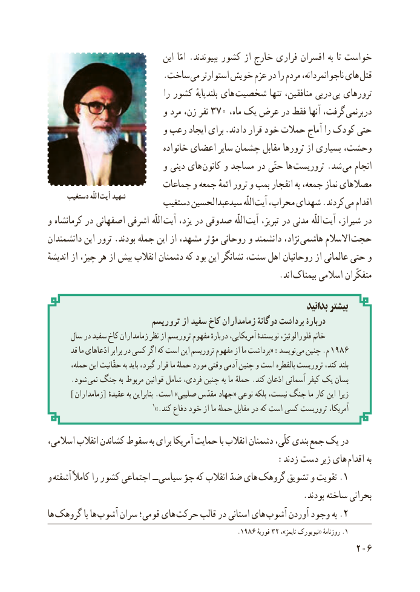

# PDF page 214

اىن  امّا .بپىوندند کشور از خارج فرارى افسران به تا خواست
                           .ساخت مى استوارتر خوىش عزم در را مردم ناجوانمردانه، هاى قتل
                                  را کشور بلندپاىهٔ هاى شخصىت تنها منافقىن، درپى پى ترورهاى
                            و مرد زن، نفر 370 ،ىکماه   عرض در فقط آنها گرفت،  دربرنمى
                            و رعب اىجاد براى .دادند قرار خود حمالت آماج را کودک حتى
                                 خانواده اعضاى ساىر چشمان مقابل ترورها از بسىارى وحشت،
                            و دىنى هاى  کانون و مساجد در حتّى ها ترورىست .شد  مى انجام
                         جماعات و جمعه ائمهٔ ترور و بمب انفجار به جمعه، نماز مصالهاى
     دستغیب اللّه  آيت شهید        دستغىب سىدعبدالحسىن اللّه آىت محراب، شهداى .کردند مى اقدام
و کرمانشاه در اصفهانى اشرفى اللّه آىت ىزد، در صدوقى اللّه آىت تبرىز، در مدنى اللّه آىت شىراز، در
دانشمندان اىن ترور .بودند جمله اىن از مشهد، مؤثر روحانى و دانشمند نژاد،  هاشمى االسالم حجت
اندىشهٔ از چىز، هر از بىش انقالب دشمنان که بود اىن نشانگر سنت، اهل روحانىان از عالمانى حتى و
                              . اند بىمناک اسالمى متفکّران

                                                                          بدانید بیشتر
                          ترورىسم از سفىد کاخ زمامداران دوگانۀ برداشت دربارۀ
      سال در سفىد کاخ زمامداران نظر از ترورىسم مفهوم دربارهٔ آمرىکاىى، نوىسندهٔ فلورالوئىز، خانم
       قد ما ادّعاهاى برابر در کسى اگر که است اىن ترورىسم مفهوم از ما برداشت« :نوىسد مى چنىن .م 1986
،بلندحمله اىن حقّانىت به باىد گىرد، قرار ما حملهٔ مورد وقتى آدمى چنىن و است بالفطره ترورىست کند،
      .شود نمى جنگ به مربوط قوانىن شامل فردى، چنىن به ما حملهٔ .کند اذعان آسمانى کىفر ىک بسان
        ]  [زمامداران    ٔزىراعقىده به بنابراىن .است »صلىبى مقدّس جهاد« نوعى بلکه نىست، جنگ ما کار اىن
                                  1».کند دفاع خود از ما حملهٔ مقابل در که است کسى ترورىست آمرىکا،

اسالمى، انقالب کشاندن سقوط به براى آمرىکا حماىت با انقالب دشمنان کلّى، بندى جمع ىک در
                                           :زدند دست زىر هاى  اقدام به
و آشفته کامالً را کشور اجتماعى ــ سىاسى جوّ که انقالب ضدّ هاى  .گروهک تشوىق و تقوىت 1
                                                            .بودند ساخته بحرانى
ها  گروهک با ها آشوب سران قومى؛ هاى  حرکت قالب در استانى هاى  .آشوب آوردن وجود به 2
                                                    .1986 فورىه 32 ،».تاىمز نىوىورک« روزنامهٔ 1
                                                          206

