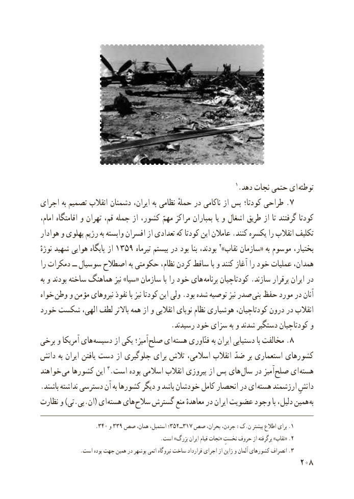

# PDF page 216

1.دهد نجات حتمى اى توطئه
اجراى به تصمىم انقالب دشمنان ایران، به نظامی حملهٔ در ناکامی از پس کودتا؛ طراحی . ٧
،ىاامام اقامتگاه و تهران قم، جمله از کشور، مهمّ مراکز بمباران   و اشغال طرىق از تا گرفتند کودتا
هوادار و پهلوی رژیم به وابسته افسران از تعدادی که کودتا اىن عامالن .کنند ىکسره را انقالب تکلىف
نوژهٔ شهىد هواىى پاىگاه از 1359 تىرماه بىستم در بود بنا بودند، 2»نقاب سازمان« به موسوم بختیار،
را دمکرات ــ سوسىال اصطالح به حکومتى نظام، کردن ساقط با و کنند آغاز را خود عملىات همدان،
به و بودند ساخته هماهنگ نىز »سىا« سازمان با را خود هاى برنامه کودتاچىان .سازند برقرار اىران در
خواه وطن و مؤمن نىروهاى نفوذ با نىز کودتا اىن ولى .بود شده توصىه نىز صدر بنى حفظ مورد در آنان
خورد شکست الهى، لطف باالتر همه از و انقالبى نوپاى نظام هوشىارى کودتاچىان، درون در انقالب
                                     .رسىدند خود سزاى به و شدند دستگىر کودتاچىان و
برخی و آمریکا های  دسیسه از یکی آمیز؛ صلح ای هسته فنّاوری به ایران دستیابی با مخالفت .٨
دانش به ایران یافتن دست از جلوگیری برای تالش اسالمی، انقالب ضدّ بر استعماری کشورهای
خواهند می کشورها این 3.است بوده اسالمی انقالب پیروزی از پس های سال در آمیز  صلح ای هسته
.باشند نداشته دسترسی آن به کشورها دیگر و باشد خودشان کامل انحصار در ای هسته ارزشمند دانشِ
نظارت و )تی.پی.ان( ای  هسته های سالح گسترش منع معاهدهٔ در ایران عضویت وجود با دلیل، همین به

                      .٣٤٠ و 339 صص١٧همان، استمپل، ٣ــ٢٥٣؛ صص بحران، جردن، :ک.ن بىشتر اطالع براى .1
  ..است »بزرگ ایران قیام نجات« نخستِ حروف از برگرفته »نقاب« 2
..است بوده جهت همین در بوشهر اتمی نیروگاه ساخت قرارداد اجرای از ژاپن و آلمان کشورهای انصراف 3
                                                          208

