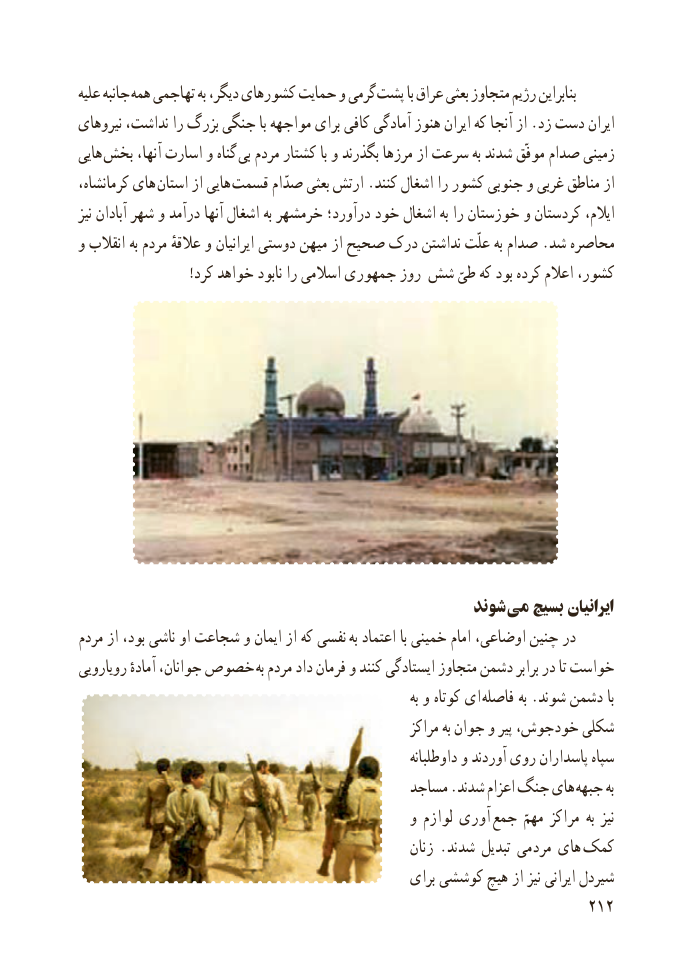

# PDF page 220

علیه جانبه همه تهاجمی به دیگر، کشورهای حمایت و گرمی پشت با عراق بعثی متجاوز رژیم بنابراین
نیروهای نداشت، را بزرگ جنگی با مواجهه برای کافی آمادگی هنوز ایران که آنجا از .زد دست ایران
هایی  بخش آنها، اسارت و گناه بی مردم کشتار با و بگذرند مرزها از سرعت به شدند موفّق صدام زمینی
کرمانشاه، های استان از هایی  قسمت صدّام بعثی ارتش .کنند اشغال را کشور جنوبی و غربی مناطق از
نیز آبادان شهر و درآمد آنها اشغال به خرمشهر درآورد؛ خود اشغال به را خوزستان و کردستان ایالم،
و انقالب به مردم عالقهٔ و ایرانیان دوستی میهن از صحیح درک نداشتن علّت به صدام .شد محاصره
                        !کرد خواهد نابود را اسالمی جمهوری روز شش طیّ که بود کرده اعالم کشور،

                                                 شوند می بسیج ایرانیان
مردم از بود، ناشی او شجاعت و ایمان از که نفسی   به اعتماد با خمینی امام اوضاعی، چنین در
رویارویی آمادهٔ جوانان، خصوص به مردم داد فرمان و کنند ایستادگی متجاوز دشمن برابر در تا خواست
                                                                             به و کوتاه ای فاصله به .شوند دشمن با
                                                          مراکز به جوان و پیر خودجوش، شکلی
                                                               داوطلبانه و آوردند روی پاسداران سپاه
                                            مساجد .شدند اعزام جنگ های جبهه به
                                                و لوازم آوری  جمع مهمّ مراکز به نیز
                                                         زنان . شدند تبدیل مردمی های  کمک
                                                    برای کوششی هیچ از نیز ایرانی شیردل
                                                          212

