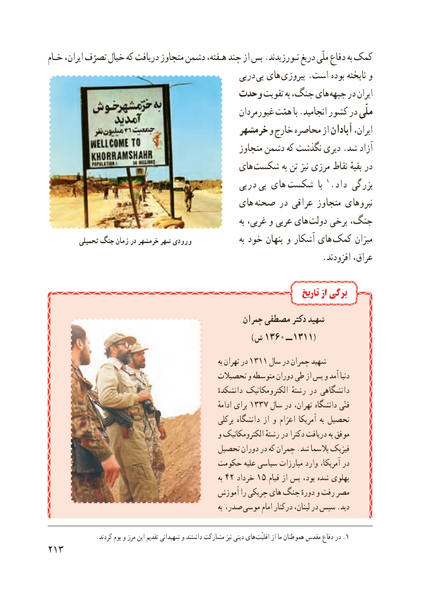

# PDF page 221

خـام ایران، تصرّف خیال که دریافت متجاوز دشمن هـفته، چند از پس .نـورزیدند دریغ ملّی دفاع به کمک
                                               درپی  پی های  پیروزی .است بوده ناپخته و
                                 وحدت تقویت به جنگ، های جبهه در ایران
                                                  غیورمردان همّت با .انجامید کشور در ملّی
                                        خرمشهر و خارج محاصره از آبادان ایران،
                                                 متجاوز دشمن که نگذشت دیری .شد آزاد
                                         های شکست به تن نیز مرزی نقاط بقیهٔ در
                                            درپی  پی های  شکست  با 1. داد بزرگی
                                        های  صحنه در عراقی متجاوز نیروهای
                                                                         به غربی، و عربی های  دولت برخی جنگ،
          تحمیلی جنگ زمان در خرمشهر شهر ورودی                  به خود پنهان و آشکار های  کمک میزان
                                                                 .افزودند عراق،

                                                                          تاریخ از برگی
                                                 چمران مصطفی دکتر شهید
                                                                                            ) ش 1360 ــ  1311(
                                                                           به تهران در 1311 سال در چمران شهید
                                          تحصیالت و متوسطه دوران طی از پس و آمد دنیا
                                                       دانشکدهٔ الکترومکانیک رشتهٔ در دانشگاهی
                                                                          ادامهٔ برای 1337 سال در تهران، دانشگاه فنّی
                                                      برکلی دانشگاه از و اعزام آمریکا به تحصیل
                                               و الکترومکانیک رشتهٔ در دکترا دریافت به موفق
                                       تحصیل دوران در که چمران .شد پالسما فیزیک
                                    حکومت علیه سیاسی مبارزات وارد آمریکا، در
                                                                           به 42 خرداد 15 قیام از پس بود، شده پهلوی
                                         آموزش را چریکی های  جنگ دورهٔ و رفت مصر
                                                                           به صدر، موسی  امام درکنار لبنان، در سپس .دید

                .کردند بوم و مرز این تقدیم شهیدانی و داشتند مشارکت نیز دینی های .اقلیّت از ما هموطنان مقدس دفاع در 1
213

