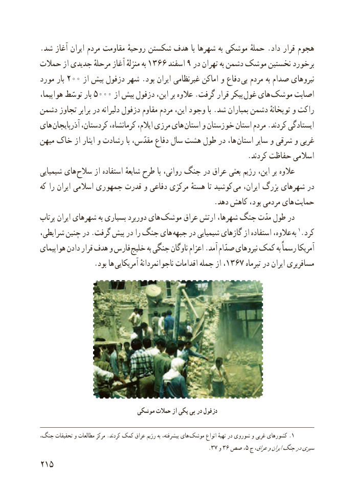

# PDF page 223

.شد آغاز ایران مردم مقاومت روحیهٔ شکستن هدف با شهرها به موشکی حملهٔ .داد قرار هجوم
حمالت از جدیدی مرحلهٔ آغاز منزلهٔ به 1366 اسفند 9 در تهران به دشمن موشک نخستین برخورد
مورد بار 200 از بیش دزفول شهر .بود ایران غیرنظامی اماکن و دفاع بی مردم به صدام نیروهای
هواپیما، توسّط بار 5000 از بیش دزفول این، بر عالوه .گرفت قرار پیکر  غول های  موشک اصابت
دشمن تجاوز برابر در دلیرانه دزفول مقاوم مردم این، وجود با .شد بمباران دشمن توپخانهٔ و راکت
های آذربایجان کردستان، کرمانشاه، ایالم، مرزی های استان و خوزستان استان مردم .کردند ایستادگی
میهن خاک از ایثار و رشادت با مقدّس، دفاع سال هشت طول در ها، استان سایر و شرقی و غربی
                                                        .کردند حفاظت اسالمی
شیمیایی های سالح از استفاده شایعهٔ طرح با روانی، جنگ در عراق بعثی رژیم این، بر عالوه
که را ایران اسالمی جمهوری قدرت و دفاعی مرکزی هستهٔ تا کوشید می ایران، بزرگ شهرهای در
    . دهد کاهش بود، مردمی های حمایت
پرتاب ایران شهرهای به بسیاری دوربرد های موشک عراق ارتش شهرها، جنگ مدّت طول در
شرایطی، چنین در .گرفت پیش در را جنگ های جبهه در شیمیایی گازهای از استفاده عالوه،  به 1.کرد
هواپیمای دادن قرار هدف و فارس خلیج به جنگی ناوگان اعزام .آمد صدّام نیروهای کمک به رسماً آمریکا
               .بود ها  آمریکایی ناجوانمردانهٔ اقدامات جمله از ،1367 تیرماه در ایران مسافربری

                            موشکی حمالت از یکی پی در دزفول

،هایجنگ تحقیقات و مطالعات مرکز .کردند کمک عراق رژیم به پیشرفته،  .موشک انواع تهیهٔ در شوروی و غربی کشورهای 1
                                                        .37 و٣،٦ صص 5 ج عراق،وایرانجنگدرسیری
215

