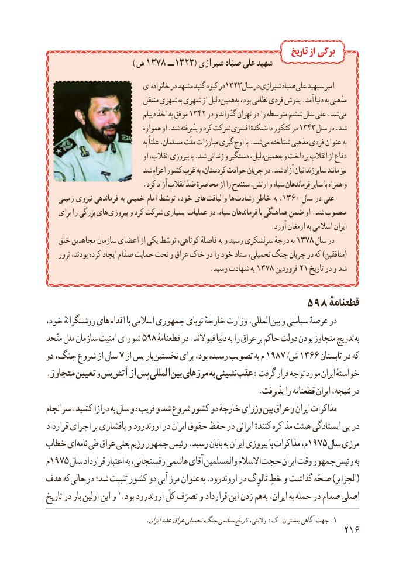

# PDF page 224

تاریخ از برگی
                                        ) ش 1378 ــ 1323( شیرازی صیّاد علی شهید
                         ای خانواده در مشهد گنبد کبود در1323 سال در شیرازی صیاد علی سپهبد امیر
                               منتقل شهری به شهری از دلیل همین به بود، نظامی فردی پدرش .آمد دنیا به مذهبی
                                      دیپلم اخذ به موفق 1342 در و گذراند تهران در را متوسطه ششم سال علی .شد می
                                همواره او .شد پذیرفته و کرد شرکت افسری دانشکدهٔ کنکور در 1343 سال در .شد
                                            به علناً مسلمان، ملّت مبارزات گیری اوج با .شد می شناخته مذهبی فردی عنوان به
                                    او انقالب، پیروزی با .شد زندانی و دستگیر دلیل، همین به و پرداخت انقالب از دفاع
                       شد اعزام کشور غرب به کردستان، حوادث جریان در .شد آزاد زندانیان سایر مانند نیز
                            .کرد آزاد ضدّانقالب محاصرهٔ از را سنندج ارتش، و سپاه فرماندهان سایر با همراه و
    زمینی نیروی فرماندهی به خمینی امام توسّط خود، های لیاقت و ها رشادت خاطر به ،1360 سال در علی
    برای را بزرگی های پیروزی و کرد شرکت بسیاری عملیات در سپاه، فرماندهان با هماهنگی ضمن او .شد منصوب
                                                                .آورد ارمغان به اسالمی ایران
   خلق مجاهدین سازمان اعضای از یکی توسّط کوتاهی، فاصلهٔ به و رسید سرلشکری درجهٔ به 1378 سال در
    ترور بودند، کرده ایجاد صدّام حمایت تحت و عراق خاک در را خود ستاد تحمیلی، جنگ جریان در که )منافقین(
             .1378رسید شهادت به      فروردین 21 تاریخ در و شد

                                      598 قطعنامۀ
خود، روشنگرانهٔ های اقدام با اسالمی جمهوری نوپای خارجهٔ وزارت المللی، بین و سیاسی عرصهٔ در
متّحد ملل سازمان امنیت شورای 598 قطعنامهٔتدریجدر .قبوالند دنیا به را عراق بر حاکم دولت بودن متجاوز          به
دو جنگ، شروع از سال 7 از پس بار نخستین برای بود، رسیده تصویب به م 1987 /ش 1366 تابستان در که
.متجاوز تعیین و بس آتش از پس المللی بین مرزهای به نشینی عقب :گرفت قرار توجه مورد ایران خواستهٔ
                                                     .پذیرفت را قطعنامه ایران نتیجه، در
سرانجام .کشید درازا به سال دو قریب و شد شروع کشور دو خارجهٔ وزرای بین عراق و ایران مذاکرات
قرارداد اجرای بر پافشاری و رود اروند در ایران حقوق حفظ در ایرانی کنندهٔ مذاکره هیئت ایستادگی پی در
خطاب ای نامه طی عراق بعثی رژیم جمهور رئیس .رسید پایان به ایران پیروزی با مذاکرات م، 1975 سال مرزی
م1975 سال قرارداد اعتبار به رفسنجانی، هاشمی آقای والمسلمین االسالم حجت ایران وقت جمهور رئیس به
هدف که درحالی شد؛ تثبیت کشور دو آبی مرز عنوان به رود، (اروند در تالوِگ خطِ و گذاشت صحّه )الجزایر
تاریخ در بار اولین این و 1.بود رود اروند کلّ تصرّف و قرارداد این زدن هم به ایران، به حمله در صدام اصلی
 ..ایرانعلیهعراقتحمیلیجنگسیاسیتاریخوالیتی، :ک .ن بیشتر آگاهی جهت 1
                                                          216

