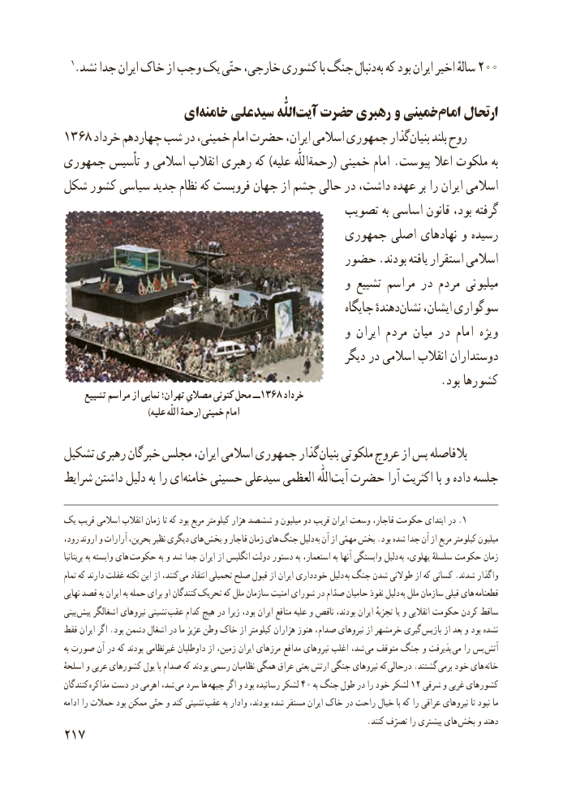

# PDF page 225

1.نشد جدا ایران خاک از وجب یک حتّی خارجی، کشوری با جنگ دنبال به که بود ایران اخیر سالهٔ 200

                ای‌خامنه علی سید اللّٰه‌آیت حضرت رهبری و خمینی امام ارتحال
۱۳۶۸ خرداد چهاردهم شب در خمینی، امام حضرت ایران، اسالمی جمهوری گذاربنیان‌     بلند روح
جمهوری تأسیس و اسالمی انقالب رهبری که )علیه رحمةاللّٰه( خمینی امام .پیوست اعال ملکوت به
شکل کشور سیاسی جدید نظام که فروبست جهان از چشم حالی در داشت، عهده بر را ایران اسالمی
                                          تصویب به اساسی قانون بود، گرفته
                                        جمهوری اصلی نهادهای و رسیده
                                    حضور .بودند یافته استقرار اسالمی
                                                  و تشییع مراسم در مردم میلیونی
                                                           جایگاه دهندهٔنشان‌    ایشان، سوگواری
                                                  و ایران مردم میان در امام ویژه
                                                       دیگر در اسالمی انقالب دوستداران
                                                                  .بود کشورها
     تشییع مراسم از نمایی تهران؛ مصالیِ کنونی محل ــ1368 خرداد
                               )علیه اللّٰه رحمة( خمینی امام

تشکیل رهبری خبرگان مجلس ایران، اسالمی جمهوری گذاربنیان‌   ملکوتی عروج از پس بالفاصله
شرایط داشتن دلیل به را ایخامنه‌    حسینی سیدعلی العظمی اللّٰهآیت‌  حضرت آرا اکثریت با و داده جلسه

یک قریب اسالمی انقالب زمان تا که بود مربع کیلومتر هزار ششصد و میلیون دو قریب ایران وسعت قاجار، حکومت ابتدای در .1
،رود اروند و آرارات بحرین، نظیر دیگری های  بخش و قاجار زمان های جنگ دلیل به آن از مهمّی بخش .بود شده جدا آن از مربع کیلومتر میلیون
بریتانیا به وابسته های حکومت به و شد جدا ایران از انگلیس دولت دستور به استعمار، به آنها وابستگی دلیل به پهلوی، سلسلهٔ حکومت زمان
تمام که دارند غفلت نکته این از کنند، می انتقاد تحمیلی صلح قبول از ایران خودداری دلیل به جنگ شدن طوالنی از که کسانی .شدند واگذار
نهایی قصد به ایران به حمله برای او کنندگان تحریک که ملل سازمان امنیت شورای در صدّام حامیان نفوذ دلیل به ملل سازمان قبلی های قطعنامه
بینی پیش اشغالگر نیروهای نشینی  عقب کدام هیچ در زیرا بود، ایران منافع علیه و ناقص بودند، ایران تجزیهٔ یا و انقالبی حکومت کردن ساقط
فقط ایران اگر .بود دشمن اشغال در ما عزیز وطن خاک از کیلومتر هزاران هنوز صدام، نیروهای از خرمشهر گیری  بازپس از بعد و بود نشده
به صورت آن در که بودند غیرنظامی داوطلبان از زمین، ایران مرزهای مدافع نیروهای اغلب شد،  می متوقف جنگ و پذیرفت می را بس  آتش
اسلحهٔ و عربی کشورهای پول با صدام که بودند رسمی نظامیان همگی عراق بعثی ارتش جنگی نیروهای که  درحالی .گشتند  برمی خود های  خانه
کنندگان مذاکره دست در اهرمی شد، می سرد ها جبهه اگر و بود رسانیده لشکر 40 به جنگ طول در را خود لشکر 12 شرقی و غربی کشورهای
ادامه را حمالت بود ممکن حتّی و کند نشینی عقب به وادار بودند، شده مستقر ایران خاک در راحت خیال با که را عراقی نیروهای تا نبود ما
                                                                           .کنند تصرّف را بیشتری های  بخش و دهند
217

