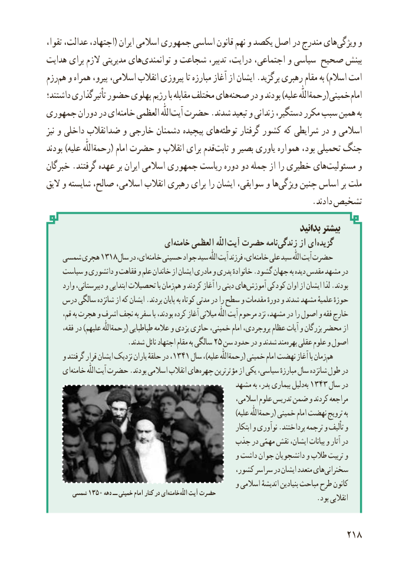

# PDF page 226

،هایتقوا عدالت، اجتهاد،( ایران اسالمی جمهوری اساسی قانون نهم و یکصد اصل در مندرج    ویژگی‌     و
هدایت برای الزم مدیریتی هایتوانمندی‌       و شجاعت تدبیر، درایت، اجتماعی، و سیاسی صحیح بینش
رزمهم‌  و همراه پیرو، اسالمی، انقالب پیروزی تا مبارزه آغاز از ایشان .برگزید رهبری مقام به )اسالم امت
داشتند؛ تأثیرگذاری حضور پهلوی رژیم با مقابله مختلف هایصحنه‌(در و بودند )علیه رحمةاللّٰه  خمینی امام
جمهوری دوران در ایخامنه‌    العظمی اللّٰهآیت‌  حضرت .شدند تبعید و زندانی دستگیر، مکرر سبب همین به
نیز و داخلی ضدانقالب و خارجی دشمنان پیچیده هایتوطئه‌     گرفتار کشور که شرایطی در و اسالمی
بودند )علیه رحمةاللّٰه( امام حضرت و انقالب برای قدمثابت‌   و بصیر یاوری همواره بود، تحمیلی جنگ
خبرگان .گرفتند عهده بر ایران اسالمی جمهوری ریاست دوره دو جمله از را خطیری هایمسئولیت‌       و
الیق و شایسته صالح، اسالمی، انقالب رهبری برای را ایشان سوابقی، و هاویژگی‌    چنین اساس بر ملت
                                                                .دادند تشخیص
                                                                          بدانید بیشتر
                           ای ‌خامنه العظمی اللّٰه آیت حضرت نامهزندگی‌     از ای‌گزیده
   شمسی هجری ۱۳۱۸ سال در ای،خامنه‌   حسینی جواد سید اللّٰه آیت فرزند ای،خامنه‌    علی سید اللّٰه آیت حضرت
    سیاست و دانشوری و فقاهت و علم خاندان از ایشان مادری و پدری خانوادهٔ .گشود جهان به دیده مقدس مشهد در
     وارد دبیرستانی، و ابتدایی تحصیالت با زمانهم‌  و کردند آغاز را دینی هایآموزش‌     کودکی اوان از ایشان لذا .بودند
   درس سالگی شانزده از که ایشان .بردند پایان به کوتاه مدتی در را سطح و مقدمات دورهٔ و شدند مشهد علمیهٔ حوزهٔ
      قم، به هجرت و اشرف نجف به سفر با بودند، کرده آغاز میالنی اللّٰه آیت مرحوم نزد مشهد، در را اصول و فقه خارج
      فقه، در )علیهم رحمةاللّٰه( طباطبایی عالمه و یزدی حائری خمینی، امام بروجردی، عظام آیات و بزرگان محضر از
                       .شدند نائل اجتهاد مقام به سالگی ۲۵ سن حدود در و شدند مندبهره‌   عقلی علوم و اصول
     و گرفتند قرار ایشان نزدیک یاران حلقهٔ در ،۱۳۴۱ سال ،)علیه رحمةاللّٰه( خمینی امام نهضت آغاز با زمانهم‌
    ایخامنه‌          اللّٰه آیت حضرت .بودند اسالمی انقالب هایچهره‌     مؤثرترین از یکی سیاسی، مبارزهٔ سال شانزده طول در
                                               مشهد به پدر، بیماری دلیلبه۱۳۴۳‌      سال در
                                                           اسالمی، علوم تدریس ضمن و کردند مراجعه
                                                                              )علیه رحمةاللّٰه( خمینی امام نهضت ترویج به
                                                                        ابتکار و نوآوری .پرداختند ترجمه و تألیف و
                                      جذب در مهمّی نقش ایشان، بیانات و آثار در
                                                      و داشت جوان دانشجویان و طالب تربیت و
                                                   کشور، سراسر در ایشان متعدد هایسخنرانی‌
                                                      و اسالمی اندیشهٔ بنیادین مباحث طرح کانون
       شمسی 1350 دهه ــ خمینی امام کنار در ایخامنه‌        اللّٰه آیت حضرت                             .بود انقالبی

                                                          218

