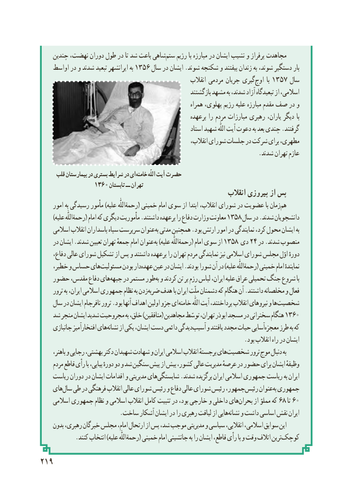

# PDF page 227

چندین نهضت، دوران طول در تا شد باعث شاهیستم‌   رژیم با مبارزه در ایشان نشیب و پرفراز مجاهدت
    اواسط در و شدند تبعید ایرانشهر به ۱۳۵۶ سال در ایشان .شوند شکنجه و بیفتند زندان به شوند، دستگیر بار
                                                         انقالب مردمی جریان گیریاوج۱۳۵۷‌      با      سال
                                                          بازگشتند مشهد به شدند، آزاد تبعیدگاه از اسالمی،
                                                            همراه پهلوی، رژیم علیه مبارزه مقدم صف در و
                                                         برعهده را مردم مبارزات رهبری یاران، دیگر با
                                                            استاد شهید اللّٰه آیت دعوت به بعد چندی .گرفتند
                                                            انقالب، شورای جلسات در شرکت برای مطهری،
                                                                        .شدند تهران عازم

      قلب بیمارستان در بستری شرایط در ایخامنه‌         اللّٰه آیت حضرت
                1360 تابستان ــ تهران
                                                               انقالب پیروزی از پس
     امور به رسیدگی مأمور )علیه رحمةاللّٰه( خمینی امام سوی از ابتدا انقالب، شورای در عضویت با زمانهم‌
      )علیه رحمةاللّٰه( امام که دیگری مأموریت .داشتند برعهده را دفاع وزارت معاونت ۱۳۵۸ سال در .شدند دانشجویان
     اسالمی انقالب پاسداران سپاه سرپرست عنوان به مدتی همچنین .بود ارتش امور در نمایندگی کرد، محول ایشان به
    در ایشان .شدند تعیین تهران جمعهٔ امام عنوان به۱۳۵۸)علیه رحمةاللّٰه( امام سوی از    دی۲۴ در .شدند منصوب
     دفاع، عالی شورای تشکیل از پس و داشتند برعهده را تهران مردم نمایندگی نیز اسالمی شورای مجلس اوّل دورهٔ
    خطیر، و حساس هایمسئولیت‌       بودن دارعهده‌   عین در ایشان .بودند شورا آن در )علیه رحمةاللّٰه( خمینی امام نمایندهٔ
   حضور مقدس، دفاع هایجبهه‌    در مستمر طوربه‌ و کردند تن بر رزم لباس ایران، علیه عراق تحمیلی جنگ شروع با
     ترور به ایران، اسالمی جمهوری نظام به زدنضربه‌   هدف با ایران ملّت دشمنان که هنگام آن .داشتند مخلصانه و فعال
    سال در ایشان نافرجام ترور .بود آنها اهداف اولین جزو ایخامنه‌          اللّٰه آیت پرداختند، انقالب نیروهای و هاشخصیت‌
   شد منجر ایشان شدید مجروحیت به خلق، )منافقین( مجاهدین توسّط تهران، ابوذر مسجد در سخنرانی هنگام ۱۳۶۰
     جانبازی افتخارآمیز هاینشانه‌    از یکی ایشان، دست دائمی دیدگیآسیب‌    و یافتند مجدد حیات آساییمعجزه‌    طرز به که
                                                                   .بود انقالب راه در ایشان
      باهنر، و رجایی بهشتی، دکتر شهیدان شهادت و ایران اسالمی انقالب برجستهٔ هایشخصیت‌         ترور موج دنبال به
     مردم قاطع رأی با پیاپی، دورهٔ دو و شد سنگین پیش از بیش کشور، عالی مدیریت عرصهٔ در حضور برای ایشان وظیفهٔ
    ریاست دوران در ایشان اقدامات و مدیریتی هایشایستگی‌       .شدند برگزیده ایران اسالمی جمهوری ریاست به ایران
    هایسال‌  طی در فرهنگی انقالب عالی شورای رئیس و دفاع عالی شورای رئیس جمهور، رئیس عنوانبه‌ جمهوری
     اسالمی جمهوری نظام و اسالمی انقالب کامل تثبیت در بود، خارجی و داخلی هایبحران۶۸‌      از مملوّ که   تا۶۰
                          .ساخت آشکار ایشان در را رهبری لیاقت از هایینشانه‌    و داشت اساسی نقش ایران
     بدون رهبری، خبرگان مجلس امام، ارتحال از پس شد، موجب مدیریتی و سیاسی انقالبی، اسالمی، سوابق این
.‌کنند انتخاب )علیه رحمةاللّٰه( خمینی امام جانشینی به را ایشان قاطع، رأی با و وقت اتالف ترینکوچک
219

