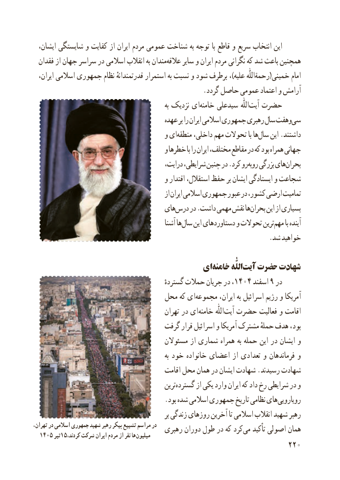

# PDF page 228

،اینایشان شایستگی و کفایت از ایران مردم عمومی شناخت به توجه با قاطع و سریع انتخاب
  فقدان از جهان سراسر در اسالمی انقالب به مندانعالقه‌     سایر و ایران مردم نگرانی که شد باعث همچنین
  ایران، اسالمی جمهوری نظام قدرتمندانهٔ استمرار به نسبت و شود برطرف ،)علیه رحمةاللّٰه(خمینی امام
                                                  .گردد حاصل عمومی اعتماد و آرامش
                                                              به نزدیک ایخامنه‌    سیدعلی  اللّٰهآیت‌  حضرت
                                        عهده بر را ایران اسالمی جمهوری رهبری سال وهفتسی‌
                                       و ایمنطقه‌     داخلی، مهم تحوالت با هاسال‌    این .داشتند
                                       و خطرها با را ایران مختلف، مقاطع در که بود همراه جهانی
                                           درایت، شرایطی، چنین در .کرد روروبه‌   بزرگی هایبحران‌
                                       و اقتدار استقالل، حفظ بر ایشان ایستادگی و شجاعت
                                                  از ایران اسالمی جمهوری عبور در کشور، ارضی تمامیت
                                    هایدرس‌    در .داشت مهمی نقش هابحران‌     این از بسیاری
                                                آشنا هاسال‌    این دستاوردهای و تحوالت ترینمهم‌     با آینده
                                                                     .شد خواهید

                                     ای‌خامنه اللّٰه‌آیت حضرت شهادت
                                                گستردهٔ حمالت جریان در ، ۱۴۰۴ اسفند۹ در
                              محل که ای‌مجموعه ایران، به اسرائیل رژیم و آمریکا
                                             تهران در ای ‌خامنه  اللّٰه‌آیت حضرت فعالیت و اقامت
                                  گرفت قرار اسرائیل و آمریکا مشترک حملهٔ هدف بود،
                                       مسئوالن از شماری همراه به حمله این در ایشان و
                                                              به خود خانواده اعضای از تعدادی و فرماندهان و
                                         اقامت محل همان در ایشان شهادت .رسیدند شهادت
                                               ترینگسترده‌       از یکی وارد ایران که داد رخ شرایطی در و
                                      .بود شده اسالمی جمهوری تاریخ نظامی هایرویارویی‌
                                                          بر زندگی روزهای آخرین تا اسالمی انقالب شهید رهبر
،درتهران در اسالمی جمهوری شهید رهبر پیکر تشییع مراسم    رهبری دوران طول در که کردمی‌   تأکید اصولی همان  1405 تیر15،هاکردند شرکت ایران مردم از نفر     میلیون
                                                           220

