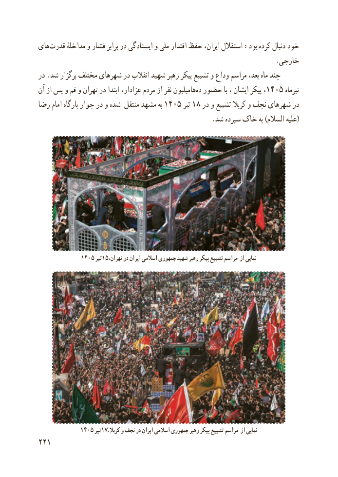

# PDF page 229

های‌قدرت مداخلهٔ و فشار برابر در ایستادگی و ملی اقتدار حفظ ایران، استقالل :بود کرده دنبال خود
                                                                      .خارجی
در .شد برگزار مختلف شهرهای در انقالب شهید رهبر پیکر تشییع و وداع مراسم بعد، ماه چند
آن از پس و قم و تهران در ابتدا عزادار، مردم از نفر ‌هامیلیون ‌ده۱۴۰۵حضور با ، ایشان پیکر ،        تیرماه
رضا امام بارگاه جوار در و شده منتقل مشهد به ۱۴۰۵ تیر۱۸ در و تشییع کربال و نجف شهرهای در
                                                   .شد سپرده خاک به )السالم علیه(

             1405 تیر15،نماییتهران در ایران اسالمی جمهوری شهید رهبر پیکر تشییع مراسم از

             1405 تیر17،نماییکربال و نجف در ایران اسالمی جمهوری رهبر پیکر تشییع مراسم از
221

