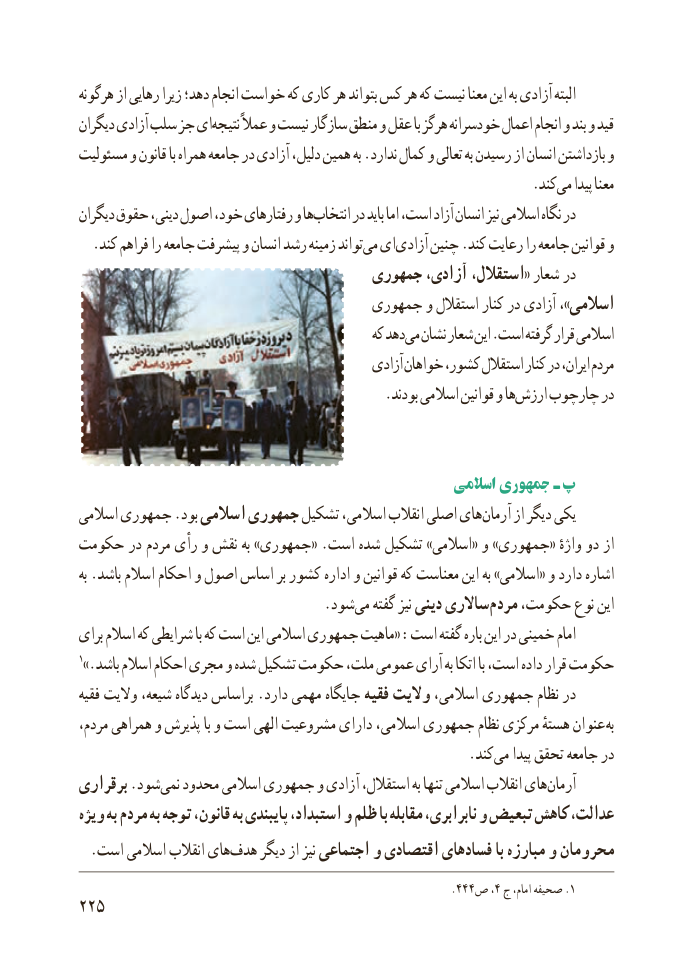

# PDF page 233

هرگونه از رهایی زیرا دهد؛ انجام خواست که کاری هر بتواند کس هر که نیست معنا این به آزادی البته
دیگران آزادی سلب جز اینتیجه‌     عمالً و نیست سازگار منطق و عقل با هرگز خودسرانه اعمال انجام و بند و قید
مسئولیت و قانون با همراه جامعه در آزادی دلیل، همین به .ندارد کمال و تعالی به رسیدن از انسان بازداشتن و
                                .‌کندمی پیدا معنا
دیگران حقوق دینی، اصول خود، رفتارهای و هاانتخاب‌     در باید اما است، آزاد انسان نیز اسالمی نگاه در
.‌کند فراهم را جامعه پیشرفت و انسان رشد زمینه تواندمی ایآزادی‌    چنین .کند رعایت را جامعه قوانین و
                                   جمهوری آزادی، استقالل،« شعار در
                                   جمهوری و استقالل کنار در آزادی ،»اسالمی
                                               که دهدمی‌  نشان شعار این .است گرفته قرار اسالمی
                                               آزادی خواهان کشور، استقالل کنار در ایران، مردم
     .‌بودند اسالمی قوانین و هاارزش چارچوب در

                                                      اسالمی جمهوری ـ پ
اسالمی جمهوری .بود اسالمی جمهوری تشکیل اسالمی، انقالب اصلی هایآرمان‌     از دیگر یکی
حکومت در مردم رأی و نقش به »جمهوری« .است شده تشکیل »اسالمی« و »جمهوری« واژهٔ دو از
به .باشد اسالم احکام و اصول اساس بر کشور اداره و قوانین که معناست این به »اسالمی« و دارد اشاره
              .‌شودمی گفته نیز دینی ساالریمردم‌   حکومت، نوع این
برای اسالم که شرایطی با که است این اسالمی جمهوری ماهیت« :است گفته باره این در خمینی امام
1».باشد اسالم احکام مجری و شده تشکیل حکومت ملت، عمومی آرای به اتکا با است، داده قرار حکومت
فقیه والیت شیعه، دیدگاه براساس .دارد مهمی جایگاه فقیه والیت اسالمی، جمهوری نظام در
مردم، همراهی و پذیرش با و است الهی مشروعیت دارای اسالمی، جمهوری نظام مرکزی هستهٔ عنوان به
                           .‌کندمی پیدا تحقق جامعه در
برقراری .شودنمی‌  محدود اسالمی جمهوری و آزادی استقالل، به تنها اسالمی انقالب هایآرمان‌
ویژه ‌به مردم به توجه قانون، به پایبندی استبداد، و ظلم با مقابله نابرابری، و تبعیض کاهش عدالت،
.‌است اسالمی انقالب هایهدف دیگر از نیز اجتماعی و اقتصادی فسادهای با مبارزه و محرومان
                                                              .444ص ،4 ج امام، صحیفه .1
225

