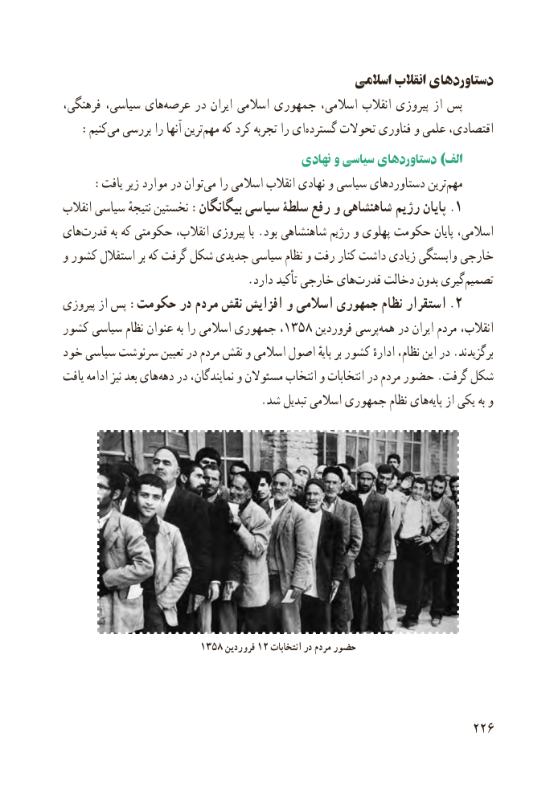

# PDF page 234

اسالمی انقالب دستاوردهای
فرهنگی، سیاسی، های‌عرصه در ایران اسالمی جمهوری اسالمی، انقالب پیروزی از پس
 :‌کنیممی بررسی را آنها ترینمهم‌   که کرد تجربه را ایگسترده‌     تحوالت فناوری و علمی اقتصادی،
                                         نهادی و سیاسی دستاوردهای )الف
 :‌یافت زیر موارد در توانمی را اسالمی انقالب نهادی و سیاسی دستاوردهای ترینمهم‌
انقالب سیاسی نتیجهٔ نخستین :بیگانگان سیاسی سلطۀ رفع و شاهنشاهی رژیم پایان .۱
های‌قدرت به که حکومتی انقالب، پیروزی با .بود شاهنشاهی رژیم و پهلوی حکومت پایان اسالمی،
و کشور استقالل بر که گرفت شکل جدیدی سیاسی نظام و رفت کنار داشت زیادی وابستگی خارجی
   .‌دارد تأکید خارجی هایقدرت دخالت بدون گیریتصمیم‌
پیروزی از پس :حکومت در مردم نقش افزایش و اسالمی جمهوری نظام استقرار . ۲
کشور۱۳۵۸سیاسی نظام عنوان به را اسالمی جمهوری ،      فروردین پرسی‌همه در ایران مردم انقالب،
خود سیاسی سرنوشت تعیین در مردم نقش و اسالمی اصول پایهٔ بر کشور ادارهٔ نظام، این در .برگزیدند
یافت ادامه نیز بعد های ‌دهه در نمایندگان، و مسئوالن انتخاب و انتخابات در مردم حضور .گرفت شکل
  .‌شد تبدیل اسالمی جمهوری نظام هایپایه از یکی به و

                        1358 فروردین 12 انتخابات در مردم حضور

                                                          226

