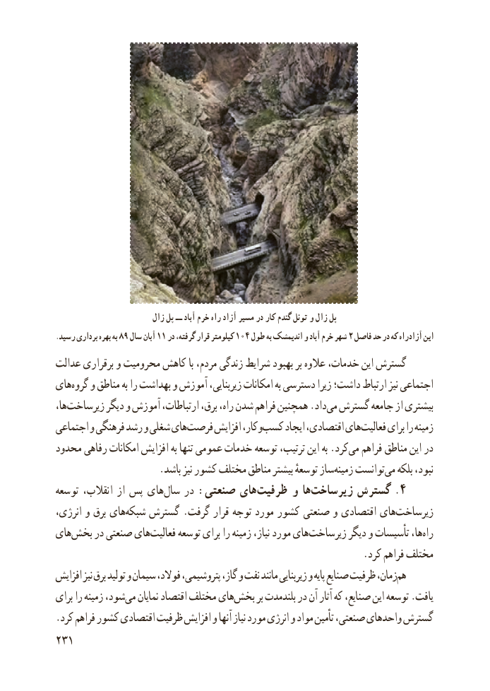

# PDF page 239

زال پل ــ آباد خرم راه آزاد مسیر در کار گندم تونل و زال پل
.رسید برداری بهره به ۸۹ سال۱۱آبان در۱۰۴گرفته، قرار کیلومتر طول۲به اندیمشک و آباد خرم شهر  فاصل حد در که راه آزاد این
عدالت برقراری و محرومیت کاهش با مردم، زندگی شرایط بهبود بر عالوه خدمات، این گسترش
هایگروه‌   و مناطق به را بهداشت و آموزش زیربنایی، امکانات به دسترسی زیرا داشت؛ ارتباط نیز اجتماعی
ها،زیرساخت‌        دیگر و آموزش ارتباطات، برق، راه، شدن فراهم همچنین .دادمی‌  گسترش جامعه از بیشتری
اجتماعی و فرهنگی رشد و شغلی هایفرصت‌     افزایش وکار،کسب‌     ایجاد اقتصادی، هایفعالیت‌     برای را زمینه
محدود رفاهی امکانات افزایش به تنها عمومی خدمات توسعه ترتیب، این به .کردمی‌   فراهم مناطق این در
 .‌باشد نیز کشور مختلف مناطق بیشتر توسعهٔ ساززمینه توانستمی‌   بلکه نبود،
توسعه انقالب، از پس های ‌سال در : صنعتی های‌ظرفیت و ها‌.زیرساخت گسترش 4
،هایانرژی و برق    شبکه‌   گسترش .گرفت قرار توجه مورد کشور صنعتی و اقتصادی هایزیرساخت‌
هایبخش‌    در صنعتی هایفعالیت‌     توسعه برای را زمینه نیاز، مورد هایزیرساخت‌        دیگر و تأسیسات ها،راه‌
                                                              .کرد فراهم مختلف
افزایش نیز برق تولید و سیمان فوالد، پتروشیمی، گاز، و نفت مانند زیربنایی و پایه صنایع ظرفیت زمان،هم‌
برای را زمینه شود،می‌   نمایان اقتصاد مختلف هایبخش‌      بر بلندمدت در آن آثار که صنایع، این توسعه .یافت
.کرد فراهم کشور اقتصادی ظرفیت افزایش و آنها نیاز مورد انرژی و مواد تأمین صنعتی، واحدهای گسترش
231

